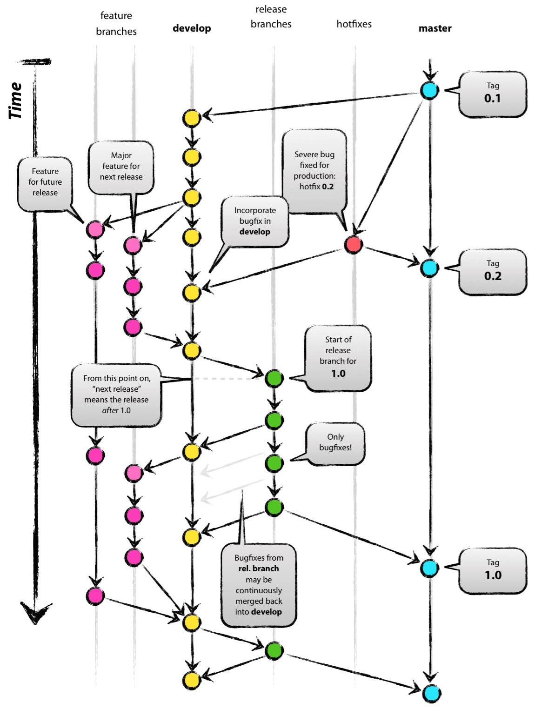
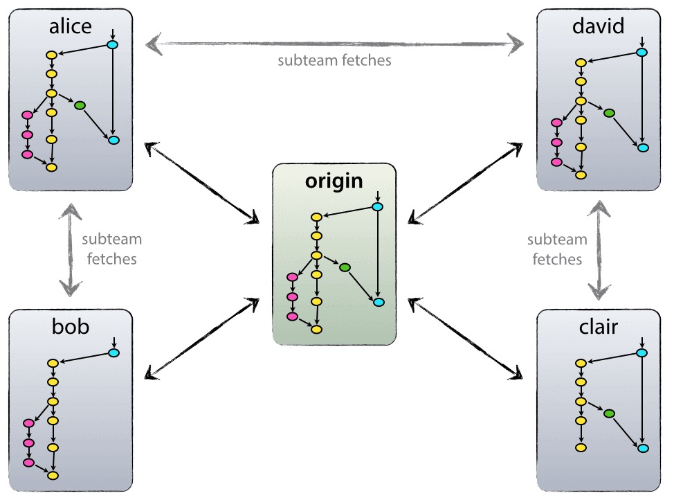
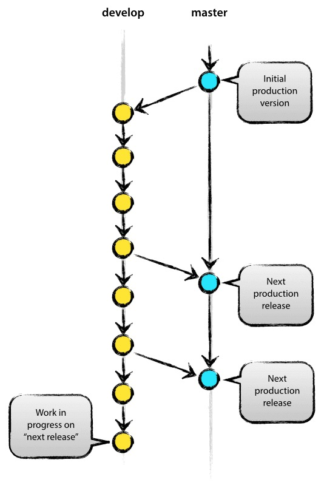
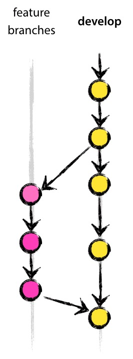
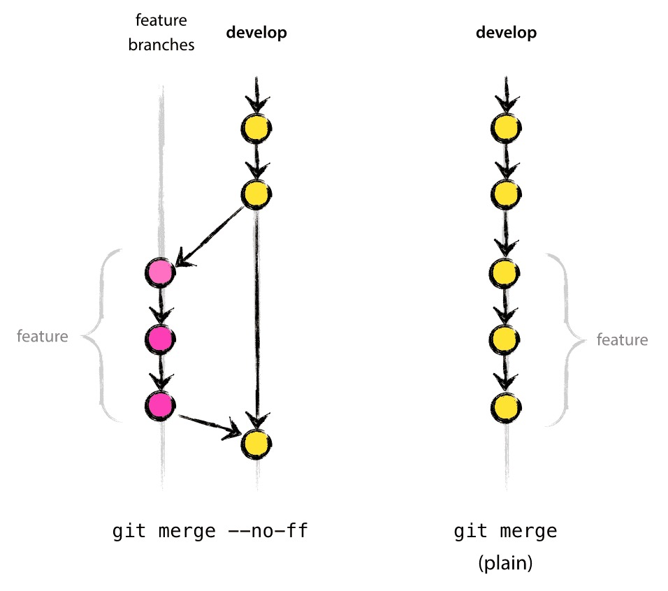
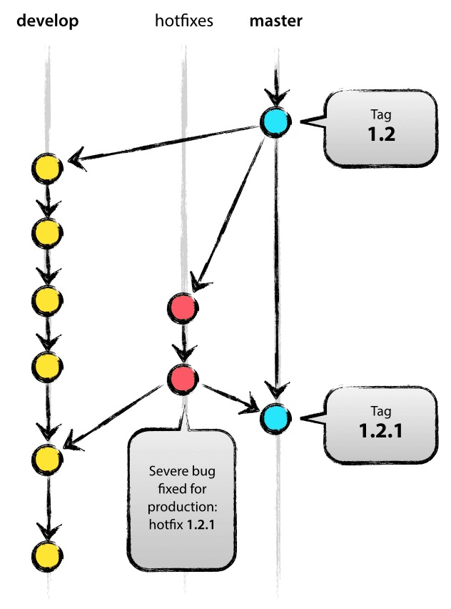

{
  "title": "一个成功的git分支模型",
  "date": "2017-04-16",
  "url": "/posts/a-successful-git-branch-model/",
  "description": "介绍主分支、开发分支、发布分支和功能分支如何协作。",
  "categories": [
    "工程"
  ],
  "cover": "banners/a-successful-git-branch-model.webp",
  "tags": [
    "git"
  ]
}

在这篇文章中我将介绍一些在过去一年中（无论是工作还是个人项目中）较为成功的开发模型，这里不会介绍很多项目的细节，仅仅是介绍分支策略和发布管理。



整个模型都是专注于Git 作为一个源代码版本管理工具进行的。

## Why git {#why-git}

尽管Git和中央源代码管理系统之间的优劣讨论从未停止过，期间的争论也很激烈，但是作为一个开发者，我更习惯用Git作为我的版本管理工具，Git彻底改变了开发者合并和分支的思维习惯。在传统的CVS/Subversion系统中 ，合并分支是一件非常恐怖的事情，你需要非常小心。

但是在Git中，这些行为变得非常地简单并且安全，这几乎变成了程序员每天工作流中的核心部分。就拿书来说，讲[CVS/Subversion系统的书](http://svnbook.red-bean.com/)中，分支和合并几乎是在后面的章节中进行介绍的（为高级用户准备的）但是在几乎所有介绍[Git的书](http://github.com/progit/progit)中，分支和合并的内容都放到了前三章作为基础内容进行介绍。

## Decentrailzed but centrailzed {#decentrailzed-but-centrailzed}

（标题我译为**分布且集中**，但是好像并不是很恰当）

在我们的日常工作中，工作较好的模型是存在一个中心化的truth”（可信）仓库，需要注意的是，这个仓库仅仅是在逻辑上被设置为一个中央仓库（因为Git是一个DVCS<分布式版本控制系统>，它在技术层面并没有一个实际意义上的中央仓库）我们将这个“中央”仓库称为`origin`，几乎所有的Giter都对这个名字非常熟悉。  


所有的开发者都从origin 拉取代码，并将修改push到`origin`仓库中。除了到中央仓库push-pull之外，开发者还可以从其他的子团队分支中拉取代码。举例来说，在开发一个非常重大的feature的时候，可能会有多个开发者共同合作，很多时候push到“中央”仓库可能还太早，这个时候这些子团队分支就起到作用了。就像上图所示，这些子团队分支就像Alice-Bob，Alice-David和Clair-David子团队分支。

从技术上来说，让Alice 定义一个新的名叫Bob的远程分支，并将其指向Bob的仓库，并不需要多少成本，反之亦然。

## The main branches {#the-main-branches}

（主分支策略）

这个开发模型在很大程度上是由现有的模型演变而来，就像下图所示。核心仓库有两个无限生命周期的分支：

- master
- develop

在`origin`仓库的`master`分支相信对所有的Git user一定非常熟悉，与master分支同时存在的分支并行发展，被称为`develop`分支。



我们通常将`origin/master`分支作为源代码的`HEAD`，并将其标记为`production-ready（可供发布）`状态。

我们把`origin/develop`分支作标记为最新开发进度的`HEAD`，所有在`develop`分支上所做的改变都将体现在下个发布版本中。有的人将这个分支为“集成分支”，很多自动化的预发布版本都是从这个分支编译而来。

当`develop`分支上的源代码达到了一个可以发布的点的时候，所有的变更都将以某种方式合并回`master`并将打上一个发布tag。当然具体是怎么做的将在今后进行讨论。

因此，每次将变更合并到`master`就意味着新的生成版本发。所以这件事需要非常严格地进行审核，从理论上讲，我们可以在每次`commit`到`maser`分支的时候，用git hooks进行自动化编译，并自动化地将我们的软件发布到我们的生产服务器。

## Supporting branches {#supporting-branches}

除了`main`分支和`develop`分支，我们的开发模型还拥有很多支持分支来帮助团队成员之间进行协作，这些分支可以方便跟踪新特性，为生产发布做准备和快速热修复产品中的问题。不像前面提到的主要分支，这些分支最终都会本删除，所以这些分支的生命周期是有限的。

支持分支主要分为以下三类：

- Feature branches
- Release branches
- Hotfix branches

这些分支都有其自身的目标，并遵守相应严格的规则去确定哪个分支是其的源分支，那些分支是其需要合并进入的分支。

实际上从技术层面这些分支和普通分支一样并不是特殊的分支。这些分支的分类取决于我们如何去使用它。这些分支实际上就是普通的Git分支。

## Feature branches {#feature-branches}

可能检出的分支：

- develop

需要并入的分支：

- develop

分支可以命名为：

除了：`master`,`develop`,`release-*`或者`hotfix-*`之外的名称



Feature分支（有的时候也成为主题分支）是在开发新的特性或者是发布新的版本的时候使用的。当开始一个新的特性的开发的时候，往往新特性的内容在当时是不可见的，但是实质上，feature将会一直存在直到该feature开发完毕，最终将会被合并回`develop`分支（为了能够真正地将新特性加入到上游分支，）或者被废弃（例如令人失望的尝试）。

Feature 分支往往只存在在开发仓库中，而不是在`origin`仓库中。

### Creating a feature branch {#creating-a-feature-branch}

当你需要开始开发一个新的feature的时候，你可以从develop分支检出新的feature分支：

```shell
$ git checkout -b myfeature develop

此时将会切换到新的分支 "myfeature"
```

### 在develop分支中加入新的feature {#在develop分支中加入新的feature}

当你结束一个新的特性开发之后，往往需要将该分支合并到develop中将新特性真正加入到上游发布版本中：

```shell
$ git checkout develop
Switched to branch 'develop'
$ git merge --no-ff myfeature
Updating ea1b82a..05e9557
(Summary of changes)
$ git branch -d myfeature
Deleted branch myfeature (was 05e9557).
$ git push origin develop
```

这里的`no-ff`选项往往会通过创建一个新的commit开进行合并，就算这个合并能够用`fast-forward`方式进行处理。这样就可以避免丢失一些在开发过程中的提交历史信息，通过这种方式能够正确地组织相应的commit以及将feature很好地进行合并。我们可以通过下图进行比较理解：



在后面的例子中，我们是无法看到在实现分支的时候的所有提交历史的，你只能通过阅读相应的log开确定提交历史，当然回滚整个feature（例如一组commit）变成了一件非常头痛的事情，当然如果你用课`no-ff`选项，这些事情都变得很简单。

当然，这会创建一些新的(空的)commit,但是得到的好处远远能够抵消这点不足。

## Realease branches {#realease-branches}

可能由以下分支检出：

- develop

必须要合并回以下分支：

- develop
- master

分支命名规则：

- release-\*

Release分支为新产品的发布做准备，其允许做一些一些最终的修改(last-minute dotting of i’s and t’s)。进一步说明，该类型的分支，允许少量的bug-fix以及添加一些为发布准备的说明性信息（例如版本号，编译日期等等），当release分支上的所有工作都做完之后，`develop`分支就可以完全为下一个大型的`release`接受新的提交了。

这里有一个比较关键的时间点，就是何时从`develop`分支检出新的`release`分支，这个时间点往往是`develop`分支已经能够完全反映当前发布版本所需要的所有特性。此时至少所有的需要在发行版本中所包含的（release-to-be-build）特性都已经被合并到`develop`分支中了，需要提一下的是，所有下个版本的新特性都不能够合并到`develop`分支，直至新的`release`被检出（branch off）。

显然，发布版本号是在为了即将到来的新的发布版本开启一个新的release分支的时候指定的——换句话说不要太早。这样做的原因是，当`develop`中有一些被标记为`next release`的变更，但是并不明确`next release`最终会变成0.3还是1.0，只有`release`分支开始才被确定。一个新的release分支的启用往往是在版本号被确定之后。

### 创建一个release分支 {#创建一个release分支}

发布分支是从develop分支中创建的。举例来说，当前的生产分支是1.1.5，这个时候有一个大的发布版本即将发布。此时`develop`分支应该应该已经准备好并处于`next release`状态，这个时候我们应该已经确定了具体的发布版本号为`1.2`（而不是`1.1.6`或者`2.0`），所以我们检出新的分支，并给予发布分支一个名称用于标识新的版本号。

```shell
$ git checkout -b release-1.2 develop
Switched to a new branch "release-1.2"
$ ./bump-version.sh 1.2
Files modified successfully, version bumped to 1.2.
$ git commit -a -m "Bumped version number to 1.2"
[release-1.2 74d9424] Bumped version number to 1.2
1 files changed, 1 insertions(+), 1 deletions(-)
```

在创建一个新的分支并切换到该分支之后，我们运行了一个`bump-version.sh`的脚本，这个脚本将会修改一些文件并让目前的工作空间变成能够反映新的版本特性。（当然这些修改也可以手动进行——这里的重点是需要进行一些修改）然后，这个已经被确认的版本号就会被提交。

### 结束一个release分支 {#结束一个release分支}

当一个release分支已经准备好成为一个真正的发布版本，一些相应的动作需要被执行。首先这个发布分支需要合并到`master`分支当中（切记，所有提交到master分支上的变更都是可发布的）。然后，这个`master`分支上的`commit`应该打一些标记便于将来快速查询，当然这些信息需要简单易懂。

最后，这些在`release`分支上的变更应该合并回`develop`分支，这样在后面的分支才能够拥有在这个`release`分支上的`bugfix`。

前两步的命令如下：

```shell
$ git checkout master
Switched to branch 'master'
$ git merge --no-ff release-1.2
Merge made by recursive.
(Summary of changes)
$ git tag -a 1.2
```

目前，`release`分支已经完成了它的使命，并打了一个`tag`便于今后查询。

> 说明，你也可以利用`-s`或者`-u`命令为你打的`tag`进行一些数字签名。

为了保有在`release`分支上的变更，我们需要将这些变更合并回`develop`分支。当然，用git命令：

```shell
$ git checkout develop
Switched to branch 'develop'
$ git merge --no-ff release-1.2
Merge made by recursive.
(Summary of changes)
```

这些步骤可能引起一些合并冲突（当然这是很正常的，因为我们已经修改了版本号）。如果这样，就fix这些冲突，并commit它。

到这里为止，这个`release`分支真真正正完成了它所有的使命，这个时候我们就可以把这个分支删除了，因为它已经失去了利用价值了。

```shell
$ git branch -d release-1.2
Deleted branch release-1.2 (was ff452fe).
```

## Hotfix分支 {#hotfix分支}

可能检出的分支：

- master

需要并入的分支：

- develop和master

分支可以命名为：

`hotfix-*`



`Hotfix`与`release`分支十分相似，因为它们都是为了新产品发布而准备的，尽管这个分支往往是计划外的。它们往往会在一个非修复不可的，非常紧急的或者不期望看到的行为或者bug的时候生产版本中诞生。当生产版本上一个非常严重的bug需要立即修复的时候，一个hotfix分支就被检出了，这个分支可以从master分支的相应tag中检出。

这样做的关键在于，在`develop`分支上工作的团队不需要中断当前的工作，与此同时，另一个人可以快速修复生产版本上的bug。

### 创建一个hoxfix分支 {#创建一个hoxfix分支}

`Hoxfix`分支是从`master`中诞生的，举例来说，当前的生产版本是`1.2`,而且该版本在实际业务中正运行着，但是有一些bug需要修复，而此时在`develop`分支上的版本还不稳定。我们就可以检出一个`hotfix`分支来解决这个问题。

```shell
$ git checkout -b hotfix-1.2.1 master
Switched to a new branch "hotfix-1.2.1"
$ ./bump-version.sh 1.2.1
Files modified successfully, version bumped to 1.2.1.
$ git commit -a -m "Bumped version number to 1.2.1"
[hotfix-1.2.1 41e61bb] Bumped version number to 1.2.1
1 files changed, 1 insertions(+), 1 deletions(-)
```

不要忘记将该版本号进行标记。

然后修复bug并通过一个或多个commit进行提交。

```shell
$ git commit -m "Fixed severe production problem"
[hotfix-1.2.1 abbe5d6] Fixed severe production problem
5 files changed, 32 insertions(+), 17 deletions(-)
```

### 结束一个hotfix分支 {#结束一个hotfix分支}

当bug结束修复，这个bugfix分支需要重新合并到`master`分支中，而且也要同时合并到`develop`分支中，这是为了确保这些bugfix能够真正合并到下个发布版本中。这里就和结束release分支很像了。

```shell
$ git checkout master
Switched to branch 'master'
$ git merge --no-ff hotfix-1.2.1
Merge made by recursive.
(Summary of changes)
$ git tag -a 1.2.1
```

> 说明，你也可以利用`-s`或者`-u`命令为你打的`tag`进行一些数字签名。

然后将bugfix分支合并到develop分支中：

```shell
$ git checkout develop
Switched to branch 'develop'
$ git merge --no-ff hotfix-1.2.1
Merge made by recursive.
(Summary of changes)
```

这里有一个例外，如果**此时有一个`release`分支存在，这个hotfix就需要合并到release分支中，而不是develop分支**。将hotfix合并到release分支中，是因为，在release分支结束的时候，最终也会合并入develop分支中，这样最终的结果也是讲bugfix安全地合并到了develop分支中。

最后删除hotfix分支：

```shell
$ git branch -d hotfix-1.2.1
Deleted branch hotfix-1.2.1 (was abbe5d6).
```

## 总结 {#总结}

虽然在这个分支模型中，没有什么令人震惊的奇技淫巧，但开篇的那个大图所标示的分支模型已经被证明在实际开发中能够起到非常大的作用。这个模型提供了一个优雅的协作范式，它易于理解，并能够让整个团队一直保持易于理解并便于协作的状态。

这里有一副[PDF版本](http://nvie.com/files/Git-branching-model.pdf)的高质量模型图，将它下载下来并作为一个快速查询图用吧！

当然这里还有一个gitflow的[keynote](http://github.com/downloads/nvie/gitflow/Git-branching-model-src.key.zip)，你可以下载下来用哦;)
