{
  "title": "使用 pubma 对区块链网络进行混沌测试",
  "date": "2018-09-12",
  "url": "/posts/chaos-testing-by-pubma/",
  "description": "记录如何把故障注入用于区块链网络测试，以及测试时观察到的现象。",
  "categories": [
    "系统"
  ],
  "cover": "banners/chaos-testing-by-pubma.webp",
  "tags": [
    "区块链",
    "混沌测试"
  ]
}

> Author: 陈权@hyperchain

## 0x01 问题明确 {#0x01-问题明确}

当前我们需要模拟如下场景：

- 节点在高网络延迟下的表现
- 节点在高网络丢包率下的表现

有些bug我们是在比较苛刻的网络条件下测试得到的，而按照传统的经验，我们会想办法将环境部署到互联网上进行测试，但是这种方式非常原始，而且得到的结果也具备大量的偶然性，我们想要复现相同的结果也是十分困难的，因此我们使用容器技术对不同的网络情况进行模拟，以期得到可控的网络抖动测试环境。

## 0x02 pumba 工具介绍 {#0x02-pumba-工具介绍}

先对容器网络Chaos-testing 工具`pubma`进行简单介绍，以及相关使用的说明。

### What is Pubma(a)? {#what-is-pubmaa}

相信出生于90年代的小伙伴们都知道一个电影叫 **The Lion King（狮子王）**，里面有一个角色的名字就叫**Pumbaa**，在Swahili语中，**Pumbaa**的意识是”保持愚蠢，无知，以及懒惰”。当然这个工具起这个名字的内涵大概就是想模拟一个“愚蠢的，不可预知的环境”的意思。

### Pumba 能做什么？ {#pumba-能做什么}

简单地说，Pubma 能够完成包括对Docker容器的 `kill`，`stop`， `remove`，`pause`。

当然， Pubma 也能够完成网络模拟，模拟包括一系列的网络问题（延迟，丢包，使用不同的丢包模型，带宽限制等等）。针对网络模拟，Pumba使用的是Linux内核`tc` `netem`实现的。 如果目标container不支持tc的话，Pumba将会使用sidekick 附着到目标容器进行控制。

### 怎么使用 Pumba {#怎么使用-pumba}

通常可以传一个容器列表到Pumba中，可以简单地写一个正则表达式来选择匹配的容器。如果你没有指定容器，那么Pumba将会对所有运行的容器进行干预。

如果你使用了`--random`选项，那么Pumba将会在提供的容器列表中选择一些随机容器进行干扰。

你也可以通过传入一些重复参数，以及持续时间参数来更加精细地控制你需要产生的**chaos 混沌**。

### 如何安装 pumba {#如何安装-pumba}

#### 源码安装 {#源码安装}

```bash
# Download binary from https://github.com/gaia-adm/pumba/releases
curl -L https://github.com/alexei-led/pumba/releases/download/0.5.2/pumba_darwin_amd64 --
# Linux
curl -L https://github.com/alexei-led/pumba/releases/download/0.5.2/pumba_linux_amd64 --
output /usr/local/bin/pumba
chmod +x /usr/local/bin/pumba && pumba --help
Install with Homebrew (MacOS only)
brew install pumba && pumba --help
```

# {#heading}

#### 使用 Docker 镜像 {#使用-docker-镜像}

```bash
docker run gaiaadm/pumba pumba --help
```

### Pumba 使用例子 {#pumba-使用例子}

1. 你可以通过`--help`来查看帮助：

```bash
# pumba help
pumba --help

pumba kill --help

pumba netem delay --help
```

2. 通过`^test`正则随机kill掉一些 Docker 容器

```bash
# 在第一个terminal中运行7个测试容器，并什么都不做
for i in {0..7}; do docker run -d --rm --name test$i alpine tail -f /dev/null; done

# 然后运行一个 名叫 `skipme` 的容器
docker run -d --rm --name skipme alpine tail -f /dev/null

# 在另一个 terminal 中查看当前运行的docker 容器
watch docker ps -a

# 回到第一个terminal中，然后每隔10s kill一个'test'开头的容器，并且忽略`skipme`容器
pumba --random --interval 10s kill re2:^test

你可以随时按下 Ctrl-C 来停止 Pumba
```

3. 为ping 命令增加 `3000ms`(`+-50ms`)延迟，持续20s，并使用`normal` 分配 模型

```bash
# 运行 "ping" 容器在terminal 1中
docker run -it --rm --name ping alpine ping 8.8.8.8

# 在termainal2中, 运行 pumba netem delay 命令, 分配到 "ping" 容器; 使用一个 "tc" 辅助容器
pumba netem --duration 20s --tc-image gaiadocker/iproute2 delay --time 3000 jitter 50 --distribution normal ping

pumba 将会在 20s 后退出, 或者用 Ctrl-C 退出
```

4. 模拟丢包，为了模拟丢包我们需要使用三个terminal，同时使用[iperf](https://iperf.fr/)工具来监控当前的网络带宽。
   在第一个terminal中，我们运行一个 `server` Docker 容器，然后用ipref来监控这个dokcer，这个server容器会启动一个UDP服务器。

在第二个terminal中，启动一个有iperf监控报文发送容器，该容器会发UDP数据包到 server 容器。然后我们在第三个Terminal中运行 `pumba netem loss`命令，来为容器增加丢包场景。

```bash
# 创建一个docker网络
docker network create -d bridge testnet

# Terminal 1
# 运行 server 容器
docker run -it --name server --network testnet --rm alpine sh -c "apk add --no-cache iperf; sh"
# shell inside server container: run a UDP Server listening on UDP port 5001
# 在进入交互命令行的Server容器中运行UDP服务，在5001端口监听
sh$ iperf -s -u -i 1

# Terminal 2
# 运行 client 容器
docker run -it --name client --network testnet --rm alpine sh -c "apk add --no-cache iperf; sh"

# 在进入交互命令行的 client容器中，发送UDP数据报到服务端，可以看到没有数据丢包
sh$ iperf -c server -u

# Terminal 1
# 我们可以看到服务端没有数据丢包

# Terminal 3
# inject 20% packet loss into client container, for 1m
# 往client容器注入 20% 的数据丢包，持续一分钟
pumba netem --duration 1m --tc-image gaiadocker/iproute2 loss --percent 20 client

# Terminal 2
# 重新在客户端container 中发送数据报，可以看到20%的丢包
sh$ iperf -c server -u
```

## 0x03 Weave 网络 {#0x03-weave-网络}

Weave网络是一个广泛使用的，易用的，简单的容器网络解决方案，能够支持夸主机之间Docker容器的互联。通过 weave-scope可以对当前docker的网络连接情况进行监控。

> Weave通过创建虚拟网络使docker容器能够跨主机通信并能够自动相互发现。
>
> 通过weave网络，由多个容器构成的基于微服务架构的应用可以运行在任何地方：主机，多主机，云上或者数据中心。
>
> 应用程序使用网络就好像容器是插在同一个网络交换机上一样，不需要配置端口映射，连接等。
>
> 在weave网络中，使用应用容器提供的服务可以暴露给外部，而不用管它们运行在何处。类似地，现存的内部系统也可以接受来自于应用容器的请求，而不管容器运行于何处。

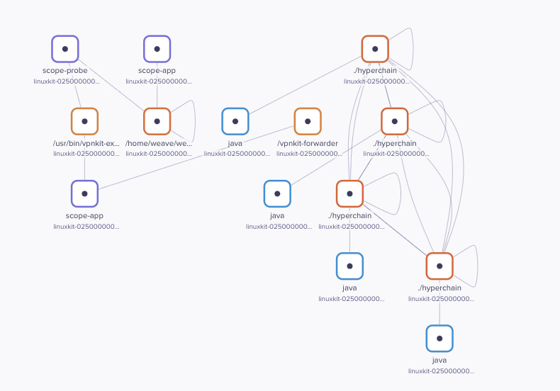

我们通过weave网络来对容器之间的网络连接进行兼容，同时我们也能够观察各个容器的资源使用情况。weave-network和weave-scope相互配合可以达到网络监控的目的。

### 安装weave-network和weave-scope {#安装weave-network和weave-scope}

weave-network 是docker 的network插件，通常配合docker-compose安装。

```bash
curl -sSL https://get.docker.com/ | sh
apt-get install -yq python-pip build-essential python-dev
pip install docker-compose
curl -L git.io/weave -o /usr/local/bin/weave
chmod a+x /usr/local/bin/weave
```

weave-scope是一个网络监控平台，通常会在本地启动：

```bash
sudo curl -L git.io/scope -o /usr/local/bin/scope
sudo chmod a+x /usr/local/bin/scope
```

### 启动weave网络，和scope监控 {#启动weave网络和scope监控}

1. 启动 weave scope:

```bash
scope launch
```

启动之后，可以在 http://localhost:4040 看到当前机器的docker情况。

2. 启动weave network

```bash
weave launch
```

## 0x04 docker-compose 和 weave 网络 {#0x04-docker-compose-和-weave-网络}

通常来说hyperchain集群以4个节点为一组，我们可以通过以下docker-compose进行配置：

```yaml
# docker-compose.yml
version: "3"

services:
  node1:
    image: hyperchain/hpc:latest
    ports:
      - "5001:5003"
    command: ['-n', '4', '-i', '1', '-p', '5000']
    dns: 172.17.0.1
    networks:
      - internal

  node2:
    image: hyperchain/hpc:latest
    ports:
      - "5002:5003"
    command: ['-n', '4', '-i', '2', '-p', '5000']
    dns: 172.17.0.1
    networks:
      - internal


  node3:
    image: hyperchain/hpc:latest
    ports:
      - "5003:5003"
    command: ['-n', '4', '-i', '3', '-p', '5000']
    dns: 172.17.0.1
    networks:
      - internal


  node4:
    image: hyperchain/hpc:latest
    ports:
      - "5004:5003"
    command: ['-n', '4', '-i', '4', '-p', '5000']
    dns: 172.17.0.1
    networks:
      - internal


networks:
  internal:
    driver: bridge # 请注意，这里需要配置为网桥模式，否则无法进行网络干预
    driver: weavemesh # 如果使用多机集群，建议使用weavemesh
```

> 简单解释一下，四个节点分别指定相应的ID和容许连接的节点数量，容器内部会自动生成相应的配置文件，同时节点的连接服务监听端口都是`5000`，所有的容器要求指定为 `node${i}`, 因为容器内部使用hostname进行连接。
>
> 我们需要注意的是，单机集群的internal的网络驱动是**bridge**，下文采用单机集群进行演示

启动容器集群：

```bash
docker-compose up
```

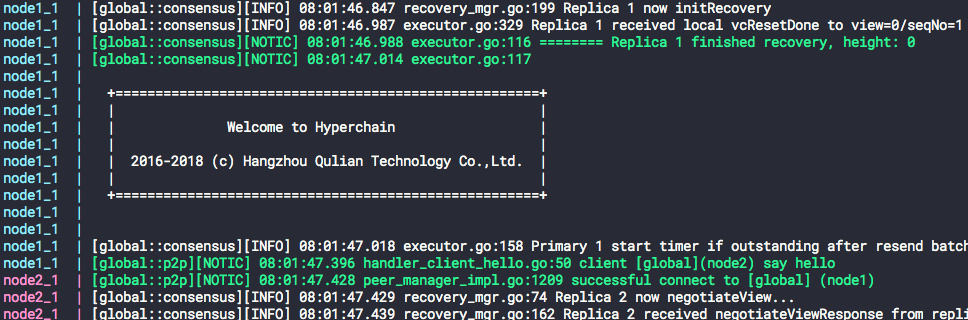

我们可以看到服务正常运行。

此时我们可以看看weave-scope里面的状态：

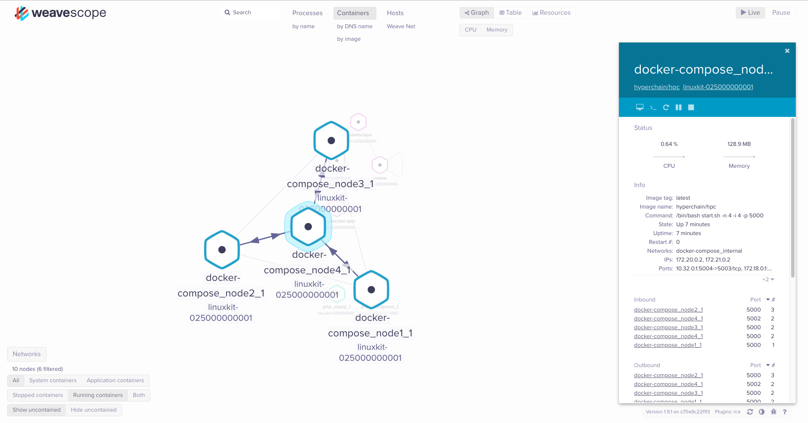

我们可以看到四个容器均是相互连接的，这个和我们的预期相符。一个简单的P2P网络集群已经正常启动，接下来我们试试使用`pumba`加点网络抖动。

## 0x05 网络抖动 chaos测试 {#0x05-网络抖动-chaos测试}

我们的网络集群已经正常启动，接下来我们为节点加上一些网络Chaos。

### 网络延迟 {#网络延迟}

利用新的terminal来运行如下命令：

```bash
pumba --random --interval 6s --log-level info netem --tc-image="gaiadocker/iproute2" --duration 5s delay --time 3000  --jitter 30   --correlation 20   re2:^docker
```

通过上述命令随机指定`docker`开头的容器接受数据包的实验增加`3000ms+-50ms`。

通过测试可以得到，系统吞吐能力直线下降。

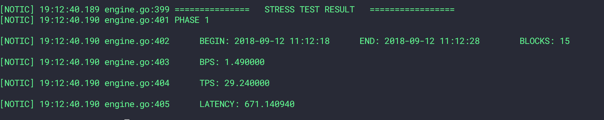

> 100tps压测，开启chaos之前

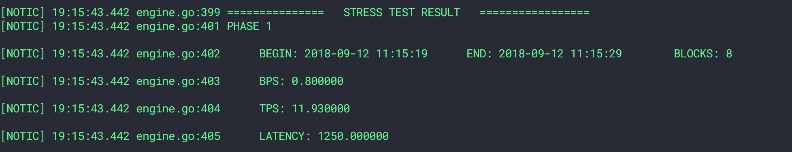

> 开启chaos之后

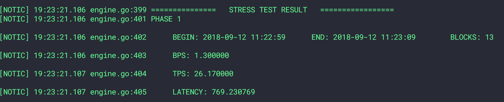

> 恢复正常之后

### 网络丢包 {#网络丢包}

- 在Terminal中运行如下命令进行丢包模拟：

```bash
pumba --random --interval 6s --log-level info netem --tc-image="gaiadocker/iproute2" --duration 5s loss --percent 80  --correlation 20   re2:^docker
```

上面的命令模拟了随机节点80%丢包率的情况，我们需要注意，不论是延迟还是丢包干扰，都会对客户端发起的请求产生影响。

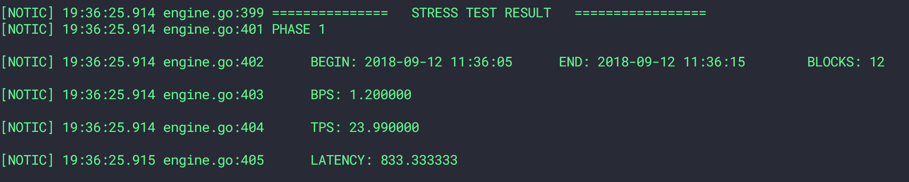

> 开启丢包干扰之前

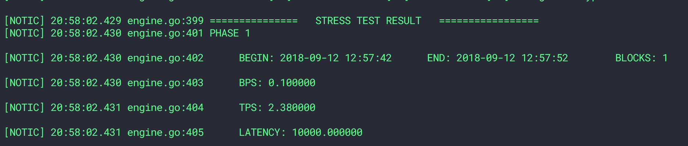

> 开启丢包干扰之后 (80%)
>
> 注意：在我的个人电脑(macbook pro 2015 early)上进行的测试存在很多额外干扰，上述数据仅仅作为参考，无法作为结论数据。

- 运行如下命令，固定干扰节点：

```bash
pumba --random --log-level info netem --tc-image="gaiadocker/iproute2" --duration 10m loss --
```

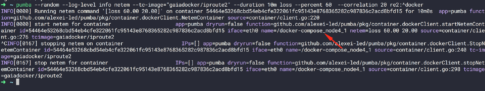

> 在去除`--interval`参数之后，我们可以看到，pumba针对`docker-compose_node4_1` 也就是我们的node4应用了丢包控制(60%)。

我们可以看到，针对`node2`的干扰是对该容器的所有网络请求进行干扰的：

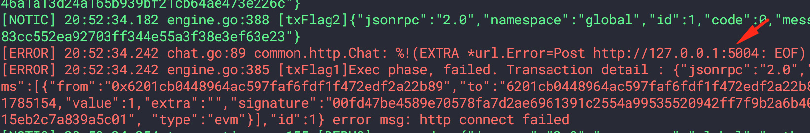

> 针对客户端的请求阻断

我们也可以看到，对于较高duration的情况下，如果丢包率较高，是会完全影响服务的正常工作的：

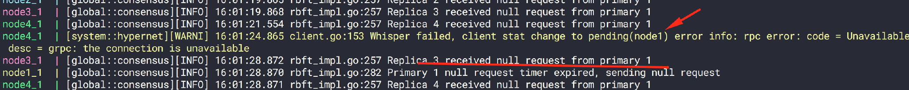

> 可以看到针对node4发送的包无法到达，而其他节点则正常

- 运行如下命令阻断node2和node3的网络(100% 10min)：

```bash
pumba --log-level info netem --tc-image="gaiadocker/iproute2" --duration 10m loss --percent 100  docker-compose_node3_1

pumba --log-level info netem --tc-image="gaiadocker/iproute2" --duration 10m loss --percent 100  docker-compose_node2_1
```

我们通过该命令观察容器之间的状态:

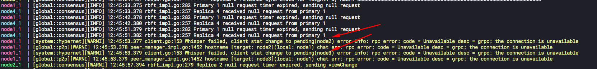

> 容器之间已经无法连接到node2/3, 对于node2/3而言则无法访问所有节点

- 运行如下命令进行重复包产生:

```bash
pumba --random --interval 11s --log-level="info" netem --tc-image="gaiadocker/iproute2" --duration 10s duplicate percent 80 --correlation 20 re2:^docker
```

可以观察到重复包在同一时间由4节点收到了：

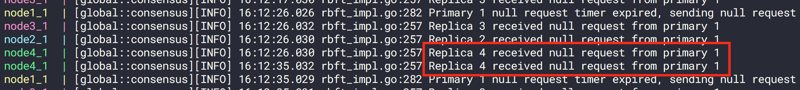

- 我们也可以将数据包进行扰乱（可能多发，可能少发），通过如下命令将80%的数据包进行指定node1节点扰乱，持续10m：

```bash
pumba --log-level="info" netem --tc-image="gaiadocker/iproute2" --duration 10m corrupt percent 100 docker-compose_node1_1
```

我们可以得到如下结果：

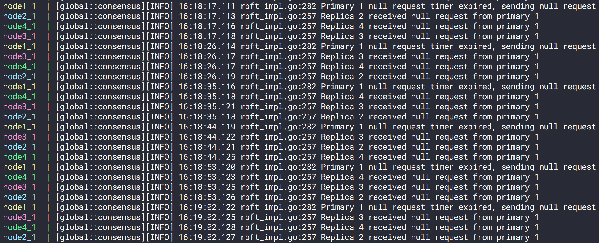

> 扰乱之前，按照每个节点收到一个包正常运行

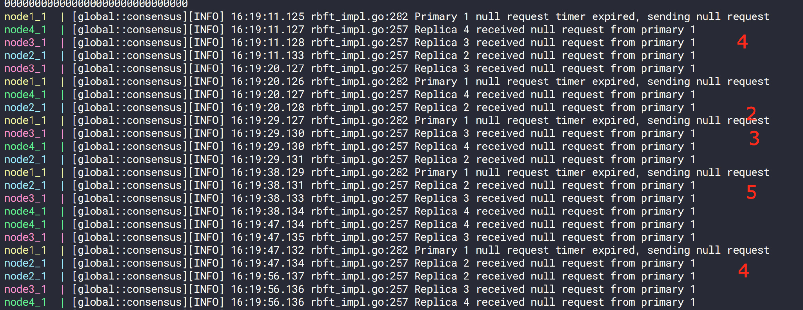

> 进行扰乱后，我们可以看到数据包的个数没有变化，但是到达时间发生了变化。

## 0x06 总结 {#0x06-总结}

我们可以看到，在docker+docker-compose组合中，pumba能够做的 Chaos-testing 非常丰富，配置也十分灵活。能够进行包括延迟，丢包，扰乱，重复包等噪音。而本身pumba这个工具也可以帮助我们对docker 容器本身进行 stop，rm， pause 等操作，可以模拟服务宕机等异常情况。pumba能够帮助我们发现在复杂的网络和物理场景下软件的一些潜在问题。

但是在使用pumba的过程当中，也遇到了一些问题，比方说mac本身是没有tc命令的，这就要求制定`--tc-image`，而如果使用了tc镜像，如果再指定`--interval`的话，那么会创建出很多个`container`，这是pumba的一个bug，笔者也给该项目提了相关的issue。

更多chaos测试和pumba的相关内容可以参考项目：[pumba](https://github.com/alexei-led/pumba)

## 0x07 {#0x07}

参考文献：

<https://codefresh.io/docker-tutorial/chaos_testing_docker/>

<https://github.com/alexei-led/pumba/blob/master/README.md>

[weave网络介绍](https://blog.csdn.net/happyanger6/article/details/71104577)

<https://microservices-demo.github.io/deployment/docker-compose-weave.html>

<https://github.com/microservices-demo/microservices-demo/blob/master/deploy/docker-compose-weave/docker-compose.yml>

<https://www.weave.works/docs/net/latest/install/using-weave/#peer-connections>
