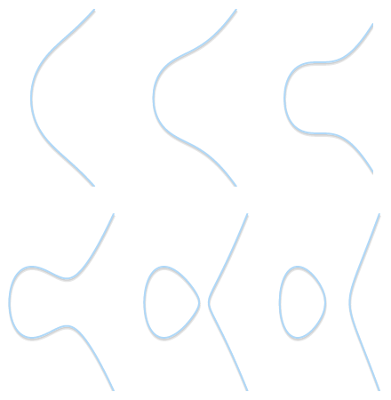
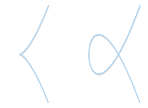
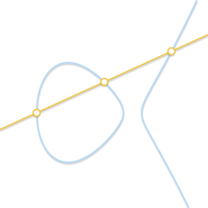
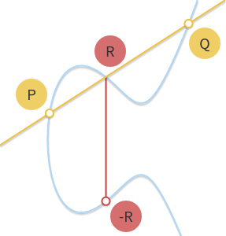
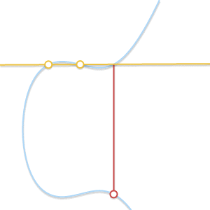
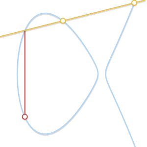

{
  "title": "Elliptic Curve Cryptography: a gentle introduction (1)",
  "date": "2017-06-12",
  "url": "/posts/elliptic-curve-cryptography_a-gentle-introduction_1/",
  "description": "从曲线方程和几何解释入手，理解椭圆曲线上的点运算。",
  "categories": [
    "工程"
  ],
  "cover": "banners/elliptic-curve-cryptography_a-gentle-introduction_1.webp",
  "tags": [
    "blocachain",
    "cryptography",
    "ecc"
  ]
}

现在我们可以在`TLS`,`PGP`,`SSH`等应用中看到椭圆曲线加密系统的踪影，这三个应用几乎构建起了现代web应用和信息技术世界的基石，更不要说Bitcoin以及其他的加密货币。

在ECC流行之前，几乎所有的公钥算法都是基于`RSA`,`DSA`以及`DH`，这些算法都是基于同余理论构建的。`RSA`以及其同类算法现在还是很流行，往往配合`ECC`一同使用，相对于`RSA`这种原理很容易被人理解，也很容易实现的算法而言，`ECC`的内部机理对大多数人而言似乎是一种未解之谜。

我将会用这一系列的文章带领大家进入椭圆曲线加密的全新世界，我的目标不是详细地说明`ECC`的全部细节(这些在网上随手都能搜索到)，而是要提供一个简单易懂的教程说明什么是`ECC`，以及为什么它是安全的，当然我也不想花费大量的时间去进行数学证明。我将会提供一些有用的样例然后用一些生动的动态交互工具和脚本去展现它们。

特别地，这里有些点事我将要提及的：

为了理解这里都在说些什么，你需要预先理解一些理论：几何和现代代数，并且需要了解对称加密和非对称加密算法，最后你需要对什么是`easy`的问题，什么是`hard`的问题有一个清晰的认识。

准备好了吗？让我们开始吧！

## 椭圆曲线 （Elliptic Curves） {#椭圆曲线-elliptic-curves}

首先，从什么是椭圆曲线（Elliptic Curver）开始，Wolfram MathWorld给了一个完整[定义](http://mathworld.wolfram.com/EllipticCurve.html): 但是我们不玩这个，简单来说，椭圆曲线就是一个可以通过等式：


$$
y^2 = x^3 + ax + b
$$


描述的点集。

其中\(4a^3+27b^2 \neq 0\)

> 因为需要排除掉 [singular curves](https://en.wikipedia.org/wiki/Singularity_mathematics) 也称奇异曲线。

上述的等式叫做椭圆曲线\_Weierstrass normal form\_



> 上图是不同椭圆曲线的形状（ b=1, a从2变化到-3 ）



> singularities 曲线:
>
> 左边, a curve with a cusp（尖点）:\(y^2=x^3\)
>
> 右边, a curve with a self-intersection（自交）\(y^2 = x^3 - 3x + 2\)上述两者均为不合法的椭圆曲线

根据不同的a和b，椭圆曲线可能在平面上展现出不同的形状，很明显，椭圆曲线是关于x轴对称的。

在我们的设计当中，我们还需要一个\_无穷点\_ [Point at infinity](https://en.wikipedia.org/wiki/Point_at_infinity)（或者称为理想点），现在我们用符号 `0` 作为作为我们的无穷点。

我们将上面的椭圆曲线的定义再明确一下，并加入刚刚的无穷点，我们可以得到如下的公式：


$$
\lbrace (x, y) \in \mathbb{R}^{2} \mid y^{2}=x^{3}+a x+b, 4 a^{3}+27 b^{2} \neq 0 \rbrace\cup\lbrace0\rbrace
$$


## 群（Group） {#群group}

群(Goup)在数学上的定义是能够进行所谓“加法”的二元运算的一种集合，通常我们将这种运算用符号`+`来表示。如果集合\(\mathbb{G}\)想要成为一个”群”,它必须有以下四个属性：

1. 闭包（**closure**）律:如果`a`和`b`都是集合\(\mathbb{G}\)的成员，那么`a+b`也是集合的\(\mathbb{G}\)成员；
2. 结合律（**associativity** \((a+b)+c=a+(b+c)\)
3. 需要存在一个孤立点（**identity element**）`0` 满足\(a+0=0+a=a\)
4. 每个元素都有一个相反数，例如所有的元素`a`都存在这样的元素`b`使得\(a+b=0\)。

如果这个群还满足：

5. 交换律(**commutativity**): \(a+b = b + a\)

这个群就被称为 *abelian group* 。

按照我们对加法的传统理解，我们可以得出以下结论：整数集合\(\mathbb{Z}\)是一个群(而且是一个阿贝尔群(abelian group))，但是自然数集合\(\mathbb{N}\)不是一个群，它不满足第四条属性。

群可以说是非常的nice,因为如果我们证明了上述四条属性的正确性，那么我们可以免费得到一堆有用的属性，例如如果一个独立元素是唯一的那么其一定有一个相反元素也是唯一的，换句话说，对任意的元素a都存在唯一的元素b使得\(a+b=0\)当然我们也可以写作\(b=-a\)，不管是直接的还是间接的，这些定理都将在后面的内容中起到非常重要的作用。

## 椭圆曲线的群律(The group law for elliptic curves) {#椭圆曲线的群律the-group-law-for-elliptic-curves}

我们可以在椭圆曲线上找到一个群，这个可以描述为：

- 群中的所有元素都是椭圆曲线上的点。
- 孤立点是无穷``。
- 其中点`P`的相反数是另一个相对于X轴对称的点。
- 加法遵从以下规则：给出三个在一条直线上的非零点`P`,`Q`,`R`，三个点之和\(P+Q+R=0\)。



> 三个点之和为0

需要注意的是最后一条规则，我们仅仅需要三个点，这三个点需要在一条直线上，但是不需要关心他们的顺序，也就是说，如果`P`,`Q`，`R`在一条直线上，那么：\(P+(Q+R)=Q+(P+R)=R+(P+Q)=\cdots=0\)

显然，我们的 `+` 运算符同时满足结合律（**associative**）和交换律（**commutative**），这其实是个阿贝尔群。

到此为止，一切都很棒！但是，我们到底应该怎么去计算两个任意点的和呢？

## 几何加法 {#几何加法}

多亏了阿贝尔群的定理，我们可以得到下列的结果：\(P+Q+R=0\ or\ P+Q=R\)。利用这个等式，我们可以利用几何方法去计算`P`和`Q`两个点的和：如果我们画一条穿过`P`点和`Q`点的直线，这条直线将会和椭圆曲线相交于第三个点`R`(这其实隐含在P,Q,R在一条直线上这个前提中).如果我们取`R`的相反数`-R`，这个就是我们要的 `P+Q`的结果。



> 画一条穿过`P`点和`Q`点的线，这条线将会穿过点`R`,而`R`的对称点`-R`就是`P+Q`的结果。

这个几何方法是行得通的，但是我们还是需要细化一下，尤其是我们需要回答几个问题：

- 如果`P=0`或者`Q=0`?显然我们没有办法画出一条线(因为0不在xy平面上)，但是我们的定义是0是我们的孤立点，`P+0=P`以及`Q+0=Q`，这个对任意的`P`和`Q`都成立。
- 如果`P = -Q`?在这种情况下，穿过两点的直线是垂直的，而且不会与椭圆曲线相交于第三个点，但是因为P是Q的相反元素，我们有\(P+Q=P+(-P)=0\)这条定理。
- 如果`P = Q`？在这种情况下，可以画出无数条穿过两点的现，这样让事情变得有点复杂，所以我们考虑一种简化情况，\(Q'\neq P\)，如果`Q'`无限接近P,将会发生什么？



> 随着两个点越来越接近，这条线渐渐变为了椭圆曲线的切线

随着`Q'`无限趋近于`P`，穿过`p`和`Q'`的线渐渐变成了曲线的切线，换句话说，我们可以说`p + p = -R`，其中`R`是曲线和曲线在`P`点的切线的交点。

- 如果`P≠Q`但是恰好又没有第三个点`R`怎么办？这种情况其实很像上面的那种情况，实际上这种情况其实就是经过`P，Q`两点的直线恰好是曲线的切线。
  

  > 如果我们的直线交于两点，换句话说，这条直线是曲线的切线，显然,最终结果是两点中的某一点的对称点。

  我们假设`P`是切点，在上面的情况中，我们可以得到`P+P=-Q`，可以转变为:`P+Q=-P`，如果，在另一种情况下，`Q`是切点，正确的等式将会变为`P+Q=-Q`。

## 代数加法(Algebraic addition) {#代数加法algebraic-addition}

如果我们让计算机做上述的点加运算，我们需要将上述的几何加法转变为算术加法，将上面的规则转换为用一组公式来描述看上去非常简单，实际上确是非常乏味的，因为它要求解三次方程。所以我们跳过无聊的部分，直接给出结果。

首先我们先排除烦人的特殊情况。我们已经知道`P+(-P)=0`，而且我们也知道`P+0=0+P=P`，所以在我们的公式中，我们仅仅考虑**非零**,**非对称**的两个点，\(P=\left(x_{P}, y_{P}\right)\) 和\(Q=\left(x_{Q}, y_{Q}\right)\)。

如果`P`和`Q`是不同的`(x_P≠x_Q)`，那么穿过这两点的线的斜率是：


$$
m=\frac{y_{P}-y_{Q}}{x_{P}-x_{Q}}
$$


这条直线和椭圆曲线的交点是第三点`R(x_R,y_R)`


$$
x_{R}=m^{2}-x_{P}-x_{Q}
\newline
y_{R}=y_{P}+m\left(x_{R}-x_{P}\right)
$$


或者，相等地：


$$
y_{R}=y_{Q}+m\left(x_{R}-x_{Q}\right)
$$


因此，\(\left(x_{P}, y_{P}\right)+\left(x_{Q}, y_{Q}\right)=\left(x_{R},-y_{R}\right)\)(请注意符号并谨记 `P+Q=-R`)

如果我们想要检查这个结果是否是正确的，我们需要检查`R`是否在曲线上，以及`P`,`Q`,`R`是否在一条直线上。检查三个点是否在一条直线上比较琐碎。但是检查`R`是否在曲线上还是比较简单的，我们需要解三次方程，当然还是很无趣。

所以我们换种方式，我们用例子来验证一下，根据我们的[visual tool](https://cdn.rawgit.com/andreacorbellini/ecc/920b29a/interactive/reals-add.html)，给出P = (1,2)和Q = (3,4)，这两个点都是在曲线:\(y^2=x^3-7x+10\)上的，这两点的和是`P+Q=-R=(-3,2)`,让我们看看等式是否成立：


$$
\begin{aligned} m &=\frac{y_{P}-y_{Q}}{x_{P}-x_{Q}}=\frac{2-4}{1-3}=1 \newline x_{R} &=m^{2}-x_{P}-x_{Q}=1^{2}-1-3=-3 \newline y_{R} &=y_{P}+m\left(x_{R}-x_{P}\right)=2+1 \cdot(-3-1)=-2 \newline &=y_{Q}+m\left(x_{R}-x_{Q}\right)=4+1 \cdot(-3-3)=-2 \end{aligned}
$$


确实是正确的。

我们注意到，这些等式在`P`点或是`Q`点是切点的时候也是work的。

让我们试试`P=（-1，4）Q=(1,2)`


$$
\begin{aligned} m &=\frac{y_{P}-y_{Q}}{x_{P}-x_{Q}}=\frac{4-2}{-1-1}=-1 \newline x_{R} &=m^{2}-x_{P}-x_{Q}=(-1)^{2}-(-1)-1=1 \newline y_{R} &=y_{P}+m\left(x_{R}-x_{P}\right)=4+-1 \cdot(1-(-1))=2 \end{aligned}
$$


我们通过可视化工具[visual tool](https://cdn.rawgit.com/andreacorbellini/ecc/920b29a/interactive/reals-add.html)也可以得到同样的结果。

**P=Q的情况需要稍稍特殊对待**：求\(x_R和y_R\)的方程和上面是一样的，但是对于\(x_P=x_Q\)这种情况，我们需要换一个求斜率的公式：


$$
m=\frac{3 x_{P}^{2}+a}{2 y_{P}}
$$


注意到，就像我们所期待的，这个用来计算m的表达式是由以下公式派生的第一个式子：


$$
y_{P}=\pm \sqrt{x_{P}^{3}+a x_{P}+b}
$$


为了证明这个结果的有效性，只需要证明`R`是否是曲线上的点，以及经过`P`和`R`两点的是否与曲线有且仅有两个焦点。但是我们不去证明这点，我们还是通过一个例子来说明，降低难度：

`P=Q=(1,2)`


$$
\begin{aligned}
m &=\frac{3 x_{P}^{2}+a}{2 y_{P}}=\frac{3 \cdot 1^{2}-7}{2 \cdot 2}=-1 \newline
x_{R} &=m^{2}-x_{P}-x_{Q}=(-1)^{2}-1-1=-1 \newline
y_{R} &=y_{P}+m\left(x_{R}-x_{P}\right)=2+(-1) \cdot(-1-1)=4
\end{aligned}
$$


我们已经知道答案的情况下\(P+P=-R=(-1,-4)\)，这是[正确的](Correct(https://cdn.rawgit.com/andreacorbellini/ecc/920b29a/interactive/reals-add.html?px=1&py=2&qx=1&qy=2)) (就不要纠结是怎么预先得到答案的，原作者为了降低难度，简单示例了一下，想要了解更多，点击链接即可，译者注)

## 标量乘法(Scalar multiplication) {#标量乘法scalar-multiplication}

在加法的基础上，我们可以定义一个新的操作：标量乘法（**scalar multiplication**）,可以表示为：


$$
n P=\underbrace{P+P+\cdots+P}_{n \text { times }}
$$


其中`n`是自然数，我也写了一个可视化工具用来演示**标量乘法**，你当然也可以试试。

就从公式上看，看上去计算nP需要**n**次加法运算，假设**n**拥有**k**个二进制数字，我们的算法复杂度将会是\(O\left(2^{k}\right)\)，当然这有点不太ok,但是实际上还有更加高效的算法。

其中有一种算法叫做 **double and add**算法，这种算法的理论可以通过例子更好地进行解释。假设我们有一个数字`n = 151`，它的二进制值是：`10010111`。那么这个二进制值可以通过2的幂次和进行计算：


$$
\begin{aligned}
151 &=1 \cdot 2^{7}+0 \cdot 2^{6}+0 \cdot 2^{5}+1 \cdot 2^{4}+0 \cdot 2^{3}+1 \cdot 2^{2}+1 \cdot 2^{1}+1 \cdot 2^{0} \newline
&=2^{7}+2^{4}+2^{2}+2^{1}+2^{0}
\end{aligned}
$$


（我们通过将n的每一位二进制数n乘以一个2的幂次）将n表示出来：

也就是说，我们可以得到：


$$
151 \cdot P=2^{7} P+2^{4} P+2^{2} P+2^{1} P+2^{0} P
$$


*double and add* 算法主要步骤如下：

- 得到一个P
- 将P乘以2所以我们得到2P
- 将2P+P（为了得到\(2^{1} P+2^{0} P\)）
- 再将\(2^{1} P\)乘以2得到\(2^{2} P\)
- 将其相加得到\(2^{2} P+2^{1} P+2^{0} P\)
- 将\(2^{2} P\)乘以2得到\(2^{3} P\)
- 不要将

$$
2^{3} P
$$

执行相加步骤
- 将\(2^{3} P\)乘以2得到\(2^{4} P\)
- 将其加上我们的结果(所以我们得到了\(2^{4} P+2^{2} P+2^{1} P+2^{0} P\))
- …

最后，我们可以通过\_double and add\_算法计算出\(151 \cdot P\)的结果

如果这还不够清楚，那么这里有一个python脚本实现了这个算法：

```python
def bits(n):
    """
    Generates the binary digits of n, starting
    from the least significant bit.


    bits(151) -> 1, 1, 1, 0, 1, 0, 0, 1
    """
    while n:
        yield n & 1
        n >>= 1

def double_and_add(n, x):
    """
    Returns the result of n * x, computed using
    the double and add algorithm.
    """
    result = 0
    addend = x

    for bit in bits(n):
        if bit == 1:
            result += addend
        addend *= 2
    
    return result
```

如果`double`和`add`的复杂度均为\_O(1)\_那么这个算法的复杂度为\_O(log n)\_或者为\_O(k)\_如果这个bit的长度是确定的)，这非常棒。这比原来的\_O(n)\_算法好多了!

## 对数（Logarithm） {#对数logarithm}

给定的\_n\_和**P**，我们至少能够在一个多项式时间内将\_Q = nP\_计算出来，但是如果反过来呢？**如果我们预先知道Q和P然后需要算出n?**这个问题就是典型的**对数问题**，我们将之称为”对数“而不是”除法“是为了整合其他的加密系统（同样的我们也用幂来取代乘法）。

我并不知道任何用来解对数问题的”easy“算法，然而[playing with multiplication](https://cdn.rawgit.com/andreacorbellini/ecc/920b29a/interactive/reals-mul.html?a=-3&b=1&px=0&py=1) 展现了一些简单的模式。举例而言：现在有一个曲线\(y^{2}=x^{3}-3 x+1\) 以及点 \(P=(0,1)\)。我们可以快速地验证是否正确。如果\_n\_是奇数,\_nP\_就在曲线的左半平面；如果n是偶数那么\_nP\_就在右半平面。如果我们做一些更加深入的实验，我们可能会找到更多的套路，最终能够带领我们写出一种能够在曲线上高效计算对数的算法。

但是这里仍然存在很多对数问题：离散问题(the *discrete* logarithm)。如果我们减小我们椭圆曲线的域，那么**纯量相乘仍然是”easy”的，而离散对数却是”hard”问题**，这个对偶关系这正是椭圆曲线加密系统最重要的一块砖瓦。

## 待续 {#待续}

接下来我们将会讨论**有限域(finite fields)**以及**离散对数问题**，敬请期待。

> 参考文献：  
> <http://andrea.corbellini.name/2015/05/17/elliptic-curve-cryptography-a-gentle-introduction/>
