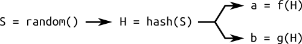
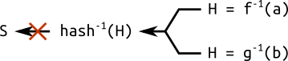
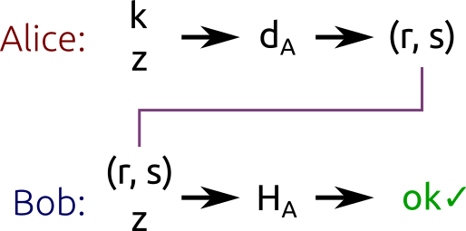

{
  "title": "Elliptic Curve Cryptography: a gentle introduction (3)",
  "date": "2017-06-15",
  "url": "/posts/elliptic-curve-cryptography_a-gentle-introduction_3/",
  "description": "说明椭圆曲线密钥、ECDSA 签名和验证的过程。",
  "categories": [
    "工程"
  ],
  "cover": "banners/elliptic-curve-cryptography_a-gentle-introduction_3.webp",
  "tags": [
    "cryptography",
    "ecc",
    "ecdsa"
  ]
}

这篇文章是系列文章ECC：优雅入门中的第三篇文章。

在之前的文章中我们知道了[什么是椭圆曲线](http://andrea.corbellini.name/2015/05/17/elliptic-curve-cryptography-a-gentle-introduction/#elliptic-curves)以及我们定义了一些[群律](http://andrea.corbellini.name/2015/05/17/elliptic-curve-cryptography-a-gentle-introduction/#group-law)为了能够在椭圆曲线上做一些数学运算。然后我们将椭圆曲线重新在一个素数的有限模整数域中进行描述。在这次重新描述过程中，我们知道了椭圆曲线是如何生成一个循环子群的，以及我们介绍了一些基本的概念：[基点(base point)](http://andrea.corbellini.name/2015/05/23/elliptic-curve-cryptography-finite-fields-and-discrete-logarithms/#base-point)，[阶(order)](http://andrea.corbellini.name/2015/05/23/elliptic-curve-cryptography-finite-fields-and-discrete-logarithms/#subgroup-order)和[辅因子(cofactor)](http://andrea.corbellini.name/2015/05/23/elliptic-curve-cryptography-finite-fields-and-discrete-logarithms/#cofactor)。

最后，我们了解了[在有限域上的标量乘法](http://andrea.corbellini.name/2015/05/23/elliptic-curve-cryptography-finite-fields-and-discrete-logarithms/#scalar-multiplication)是一个“简单”的问题，但是反过来的离散对数问题却是一个“困难”的问题。现在我们一起看看这些东西是如何应用到加密算法中的。

## 主要参数(Domain parameters)

我们的椭圆曲线算法将会在一个定义在有限域上的的椭圆曲线的子群中运行。因此我们需要如下的几个参数：
- **素数**P 描述了有限域的大小。
- **系数**a和b 用于描述椭圆曲线的方程。
- **基点**G用于生成我们的子群
- **阶**n ，子群的阶
- **辅因子**h ，子群的辅因子

一言以蔽之，我们算法中所需要的主要参数是一个6元组(p,a,b,G,n,h)。

## 随机曲线

当我们说离散对数问题是一个“困难的问题”时，其实并不完全正确。**这里有一些椭圆曲线是非常脆弱的**，这些椭圆曲线能够被一些具有特殊目的的算法快速解决。例如，所有的曲线满足 \(p = hn\) (这种曲线的有限域的阶和椭圆曲线的阶相同)能够被[Smart's attack](http://interact.sagemath.org/edu/2010/414/projects/novotney.pdf)轻而易举地攻破,这个攻击方式能够在多项式时间内将离散对数问题解决。

现在，假设我给你一些曲线的主要参数。这里就会存在一个问题，就是可能我已经发现了一些脆弱的能够被轻而易举地攻破的曲线，但是没有其它人知道，而且我能够建立一个“”快速”的算法，很快地得到我刚刚给你的离散对数的答案。那么我该如何说服你相信我，或者说我并不知道任何的弱点呢？也就是说我该如何证明，这个**曲线**是安全的（在某种意义上说，这不能被我以特殊的目的攻击）？

为了能够解决这类问题，我们常常会增加一个主要参数：**种子S（seed S）**。这是一个随机数用来生成系数a和b，或者是基点**G**，或者两者。这些参数通过对S计算hash生成。Hash，众所周知，非常容易计算，但是逆运算是非常"困难"的。


> 通过种子生成一个随机曲线的示意图：一个随机数的hash是用来计算曲线的不同参数的。
> 
> 如果我们想要作弊，通过主要参数中得到随机种子，我们需要解决一个"hard"问题：hash逆推
> 一个通过种子生成的曲线被称为**通过随机验证**。这个利用hash生成参数的理论被称为"[nothing up mu sleeve](http://en.wikipedia.org/wiki/Nothing_up_my_sleeve_number)",这个理论被广泛应用在密码学中。

这个技巧能够提供一些保障，保证这个**曲线不是被作者精心设计的隐藏的脆弱的**。实际上，如果我给你一个曲线和以和种子，它就意味着我不能够任意地选择参数a和b,而你也相对的可以肯定这个曲线不能够被我利用特定的目的攻击。而这个“相对的”的原因我将在下一篇文章中进行解释。

一个用于生成和检查随机曲线的标准算法已经在ANSI X.9.62中进行描述，这个算法是基于[SHA-1](https://en.wikipedia.org/wiki/SHA-1)。如果你对这个感兴趣，你可以阅读[a specification by SECG](http://www.secg.org/sec1-v2.pdf)了解生成可信的随机曲线算法（搜索 “Verifiably Random Curves and Base Point Generators”）。

我写了一个简单的[python脚本](https://github.com/andreacorbellini/ecc/blob/master/scripts/verifyrandom.py)用于验证所有的随机曲线，这个脚本是基于[OpenSSL](https://github.com/openssl/openssl/blob/81fc390/crypto/ec/ec_curve.c)的。我非常建议你去看看。

## 椭圆曲线加密(Elliptic Curve Cryptography)

我们在前面花了很多时间，但是最后我们还是到这一节了！废话不多说，简单粗暴：
1. **私钥**是一个随机的整数，从\({1,...,n-1}\)中选择(其中n 是子群的阶)。
2. **公钥**是一个点H满足条件H = dG(其中G是这个子群的基点)

看到了嘛？如果我们知道d和G（以及其他的主要参数），找到最终的H是很"简单"的。但是如果我们知道H和G，**找到私钥d是困难的，因为这需要我们解决一个离散对数问题**。

现在我们将介绍两个基于上述条件的公钥加密算法：ECDH(Elliptic curve Diffie-Hellman)用于加密，另一个是ECDSA(Elliptic Curve Digital Signature Algorithm)用于数字签名。

## 利用ECDH加密

ECDH 是[Diffie-Hellman算法](https://en.wikipedia.org/wiki/Diffie%E2%80%93Hellman_key_exchange)。这实际上是一个[密钥交换协议](https://en.wikipedia.org/wiki/Key-agreement_protocol),而不仅仅是一个加密算法。简而言之，ECDH定义了密钥应该如何生成，以及在双方之间如何交换。至于如何用这个密钥加密数据由我们自己决定。

那么我们简单地描述一下这个如何解决这个问题的过程（通常我们用[Alice and Bob](http://en.wikipedia.org/wiki/Alice_and_Bob)描述）。当Alice和Bob之间需要安全地交换信息，但是[第三者(中间人)](http://en.wikipedia.org/wiki/Man-in-the-middle_attack)威胁到他们，他可能截获消息，但是无法解密这些信息。这是TLS底层的一个基本理论，这里仅仅给你一个例子：

这里是整个密钥交换的过程：

1. 首先,**Alice和Bob生成他们各自的公钥和私钥**，我们假设私钥\(d_A\)和公钥\(H_A = d_AG\)是Alice的，以及私钥\(d_B\)和公钥\(H_B = d_BG\)是Bob的。需要说明的是，Alice和Bob都使用相同的主要参数，在相同的有限域上的相同椭圆曲线的相同基点G。
2. **Alice 和Bob再不安全的网络上交换各自的公钥H\_A 和H\_B**，中间人将会截获\(H_A\)和\(H_B\)，但是无法得到\(d_A\)和\(d_B\)，除非它能够解决离散对数问题。
3. **Alice 计算\(S=d_A\cdot H_B\)(用她自己的私钥和Bob的公钥)，然后Bob计算\(S = d_B\cdot HA\)(用他自己的私钥和Alice的公钥)**，这里需要说明的是Alice和Bob来说都是算出来的\(S\)都是相同的，因为：


$$
S = d_AH_B = d_A(d_BG) = d_B(d_AG) = d_BH_A
$$


中间人虽然知道\(H_A\)和\(H_B\)（当然也可能知道所有的主要参数），但是仍然无法得到共享密钥\(S\)，这被称为 Diffie-Hellman问题，它可以被如下问题描述：

> 给定三个点 P , aP 和bP, abP的答案是什么？
> 或者等价的：
> 给定三个整数\(k\),\(k^x\),\(k^y\)，\(k^{xy}\)的答案是什么？
> （后面的这个问题是在原始的Diffie-Hellman算法中被采用，基于模运算）
> [ecdh](http://andrea.corbellini.name/images/ecdh.png)
> Diffie-Hellman密钥交换，Alice和Bob能够“轻易”地计算出共享密钥，但是中间人需要解决一个“困难”的问题。
> 在Diffie-Hellman问题背后的理论在可汗学院有一个超棒的介绍，但这个仅仅是在模运算的体系上的介绍，(而不是在椭圆曲线上的介绍)。

椭圆曲线上的Diffie-Hellman问题被认为是一个"hard"的问题，他被认为其难度和离散对数相同，尽管没有有效的证明。我们知道的是这个问题没有办法"harder"了，因为解决这个问题相当于解决Diffie-Hellman问题。

现在，Alice和Bob已经得到对称密钥的，他们可以通过对称加密交换密钥了。

举例来说，他们可以用S的x坐标值作为AES或者3DES对称加密的密钥。这就和TLS的做法差不多，区别是TLS将x坐标加上了一些连接的标识码并做了一次hash。

### 接触一下ECDH

我写了另一个[简单的pyhton脚本](https://github.com/andreacorbellini/ecc/blob/master/scripts/ecdhe.py)用来计算椭圆曲线上的公/私钥对和共享密钥。

不同于我们之前提到的任何例子，这和脚本用了一个标准的曲线，而不是我们前面用的在很小的域中的简单曲线。这个曲线是 *secp256k1*，来自[SECG](http://www.secg.org/)(the “Standards for Efficient Cryptography Group”, founded by [Certicom](https://www.certicom.com/))，这和[比特币数字签名用的曲线](https://en.bitcoin.it/wiki/Secp256k1)是同一个，这里是这个曲线的一些主要参数：

- \(p = 0xffffffff ffffffff ffffffff ffffffff ffffffff ffffffff fffffffe fffffc2f\)
- \(a = 0\)
- \(b = 7\)
- \(x_G = 0x79be667e f9dcbbac 55a06295 ce870b07 029bfcdb 2dce28d9 59f2815b 16f81798\)
- \(y_G = 0x483ada77 26a3c465 5da4fbfc 0e1108a8 fd17b448 a6855419 9c47d08f fb10d4b8\)
- \(n = 0xffffffff ffffffff ffffffff fffffffe baaedce6 af48a03b bfd25e8c d0364141\)
- \(h = 1\)
  (这些值是我从OpenSSL 的源代码中找到的)

当然，你可以随意地修改脚本，改成你需要的曲线和相应的参数，但需要记住曲线需要满足素数域，和非尖锐(Weierstrass normal form)的形式，否则这个脚本将不会工作。

这个脚本虽然简单，但是却包含了所有我们前面提到的算法：点加(point addition ), double and add,ECDH，我推荐你阅读并且运行它，运行结果将如下形式：

```
Curve: secp256k1
Alice's private key: 0xe32868331fa8ef0138de0de85478346aec5e3912b6029ae71691c384237a3eeb
Alice's public key: (0x86b1aa5120f079594348c67647679e7ac4c365b2c01330db782b0ba611c1d677, 0x5f4376a23eed633657a90f385ba21068ed7e29859a7fab09e953cc5b3e89beba)
Bob's private key: 0xcef147652aa90162e1fff9cf07f2605ea05529ca215a04350a98ecc24aa34342
Bob's public key: (0x4034127647bb7fdab7f1526c7d10be8b28174e2bba35b06ffd8a26fc2c20134a, 0x9e773199edc1ea792b150270ea3317689286c9fe239dd5b9c5cfd9e81b4b632)
Shared secret: (0x3e2ffbc3aa8a2836c1689e55cd169ba638b58a3a18803fcf7de153525b28c3cd, 0x43ca148c92af58ebdb525542488a4fe6397809200fe8c61b41a105449507083)
```

### 短暂ECDH (Ephemeral ECDH)

你可能在有些地方看到ECDHE而不是ECDH，这里在ECDHE中的"E"代表"Ephemeral"，表示这次**密钥交换是临时的**而不是永久的。

ECDHE在实际中的应用也很广泛。在TLS中，客户端和服务器在连接建立的时候快速生成公私钥对。这些密钥都是经过TLS证书签名（为了授权）的，然后在双方交换。

##用ECDSA签名(Signing with ECDSA)
我们现在又有一个新的剧本：**Alice 需要用她的私钥(\(d_A\))签名一个消息，然后Bob需要用Alice的公钥(\(H_A\))验证这个消息是否真实**。除了Alice没有人能够创建一个合法的签名，但是所有的人都能够验证这个消息的真实性。

再一次地，Alice和Bob利用相同的主要参数，现在我们来研究新的算法——ECDSA,利用椭圆曲线实现的一种[数字签名算法](https://en.wikipedia.org/wiki/Digital_Signature_Algorithm)的变体。

ECDSA利用消息的hash工作，而不是消息本身。hash算法的选择取决于我们自身，但是明显地，我们需要选择一个[密码学安全的hash算法](http://en.wikipedia.org/wiki/Cryptographic_hash_function)。**消息的hash应该缩短到其bit位数和n(子群的阶)的bit位数相同,被缩短之后的hash应该是一个整数，我们用\(z\)来表示**。

对Alice来说这个算法主要有以下几步：

1. 选择一个**随机整数k**，这个整数\(k\)从\({1,…,n - 1 }\)中选择(其中 \(n\)是子群的阶)
2. 计算点\(P = kG\)(其中\(G\)是子群的基点)
3. 计算数\(r = x_p \mod n\) 其中\(x_p\)是点P的横坐标。
4. 如果\(r=0\)，从新选择一个k然后再试验一次。
5. 计算 \(s = k^{-1}(z + rd_A) mod n\) 其中\(d_A\)是Alice的私钥同时\(k^-1\)是k模nd的相反幂(where \(d_A\) is Alice’s private key and \(k^{−1}\) is the multiplicative inverse of \(k\) modulo \(n\))
6. 如果\(s = 0\),选择一个新的k然后再试一次。

这里的**(r,s)**对就是签名了。


> Alice 用自己的私钥\(d_A\)和一个随机数\(k\)对hash进行签名。Bob利用Alice的公钥\(H_A\)验证消息的合法性。
> 需要强调的是，可以通过(r,s)对得到公钥。

用简洁明了的话总结，这个算法首先生成了一个密钥(k)。这个密钥隐藏到r当中了，这点是利用点乘得到的（我们知道点乘是"easy"的，但是反过来却是"困难"的）。r 通过公式\(s = k^{-1}(z + rd_A) \mod n\)同消息的摘要绑定到一起了。

再说明一下，为了计算s,我们需要计算 \(k \mod n\)的相反幂，我们在[前面的文章中](http://andrea.corbellini.name/2015/05/23/elliptic-curve-cryptography-finite-fields-and-discrete-logarithms/#p-must-be-prime)有做解释,只有当n是素数的时候才能够奏效。**如果子群拥有一个非素数阶,ECDSA算法将不可用**。几乎所有的标准曲线拥有素数阶并不是偶然，而是因为非素数阶的曲线不能够适用于ECSDA算法。

### 验证签名(Verifying signatures)

为了验证签名，我们需要Alice的公钥\(H_A\),hash(被缩短)\(z\)和签名(r,s)。

1. 计算第一个整数\(u_1 = s^{-1}z \mod n\)
2. 计算第二个整数\(u_2 = s^{-1}r \mod n\)
3. 计算点 \(P= u_1G + u_2\cdot H_A\)

如果式子\(r = x_P \mod n\)成立，则验签通过

## 算法的正确性

第一眼我们没有办法看出这个算法的正确性，所以我们把所有的等式重新分析一下，将会豁然开朗。

让我们从\(P = u_1G + u_2H_A\)开始，从公钥的定义可知，\(H_A = d_AG(其中 \)d\_A\(是 私钥)\)。我们可以得到：


$$
P = u_1G + u_2G \ = u_1G  + u2d_AG \ = (u_1 + u_2d_A)G
$$


利用\(u_1\)和\(u_2\)的定义，我们可以得到：


$$
P = (u_1 + u_2d_A)G \ = (s^{-1}z + s^{-1}rd_A)G \ = s^{-1}(z +rd_A)G
$$


这里为了简洁起见我们忽略了 “mod n”,因为G生成的循环子群都拥有阶n，因此“mod n”是多余的。

之前我们定义\(s = k^{-1}(z + rd_A) \mod n\).两边都乘以一个\(k\)并除以一个\(s\),我们可以得到一个新的等式 \(k = s^{-1}(z+rd_A) \mod n\).将这个结果替换到我们先前得到P的等式中，我们得到：


$$
P = s^{-1}(z + rd_A)G \ =kG
$$


\*\* 这个结果同我们在步骤2中生成签名的算法一样！**当生成签名并且验证它们之时，我们都需要计算相同的点**P\*\*,并且用的是不同的公式集。这就是为什么这个算法能够work的原因。

###接触一下ECDSA
当然，我也写了一个简单的[python脚本]来演示签名的生成和验证。这个脚本有一些代码同ECDH的脚本相同，具体来说就是有关主要参数和公私钥对生成的部分。

这里是这个脚本输出的内容：

```
Curve: secp256k1
Private key: 0x9f4c9eb899bd86e0e83ecca659602a15b2edb648e2ae4ee4a256b17bb29a1a1e
Public key: (0xabd9791437093d377ca25ea974ddc099eafa3d97c7250d2ea32af6a1556f92a, 0x3fe60f6150b6d87ae8d64b78199b13f26977407c801f233288c97ddc4acca326)

Message: b'Hello!'
Signature: (0xddcb8b5abfe46902f2ac54ab9cd5cf205e359c03fdf66ead1130826f79d45478, 0x551a5b2cd8465db43254df998ba577cb28e1ee73c5530430395e4fba96610151)
Verification: signature matches

Message: b'Hi there!'
Verification: invalid signature

Message: b'Hello!'
Public key: (0xc40572bb38dec72b82b3efb1efc8552588b8774149a32e546fb703021cf3b78a, 0x8c6e5c5a9c1ea4cad778072fe955ed1c6a2a92f516f02cab57e0ba7d0765f8bb)
Verification: invalid signature
```

正如你看到的，这个脚本首先将消息进行签名（“Hello!“的byte串），然后验证了这个签名，然后它尝试用同一个签名和不同的消息(“Hi there”)进行验证，然后失败了。最后它用相同的消息但是采用了另一个随机的公钥进行验签，再一次失败了。

## k的重要性

当生成ECDSA的签名的时候，保持密钥k的保密性是非常重要的，如果我们在所有的签名中使用相同的k，过着我们的随机数生成器是可以预测的，那么**攻击者就能够到私钥！**

[这是sony前几年犯的一个错误](http://www.bbc.com/news/technology-12116051)，简单地说，那时候的PS3本来只能运行Sony用ECDSA算法签名的游戏，本来就算我写了一个PS3上的游戏我们没有办法将其发布，除非我得到了Sony的签名，但是这个过程的问题是，这个签名Sony是用相同的k生成的。
(Apparently, Sony’s random number generator was inspired by either [XKCD](http://xkcd.com/221/) or [Dilbert](http://dilbert.com/strip/2001-10-25).)

在这种情况下，我们能够轻易地通过两个签名过的游戏恢复得到Sony的私钥，我们提取出这两个游戏的hash（\(z_1\)和\(z_2\)）以及他们的签名\((r_1,s_1)\)和\((r_2,s_2)\)，以及他们的主要参数：

- 首先，我们可以得到 \(r_1 = r_2\)（因为 \(r = x_P \mod n \)和\(P = kG\) 对于两个签名而言是相同的）。
- 得到 \(s_1 - s_2 \mod n = k^{-1} (z_1 - z_2) \ mod n\) （这个结论是从s的公式中推出的）
- 现在在等式两边都乘以k:\( k(s_1 - s_2) \mod n = (z_1 - z_2) \mod n\)
- 两边同时除以(\(s_1-s_2\))来得到\(k = (z_1 -z_2)(s_1 - s_2)-1 \mod n\)

最后一个等会能够让我们通过两个hash和其对应的签名计算出k，现在我们可以通过下面的共识计算出s：


$$
s = k^{-1}(z + rd_s) \mod n \Rightarrow d_s = r^{1}(sk -z) \mod n
$$


就算k不是固定的但是是可预测的话，用类似的技术也能够得到私钥。

## 未完待续

接下来，我将会发布这个细节的第四篇文章，它将讨论如何解决离散对数问题，以及一些在椭圆曲线加密中较为重要的问题，以及ECC和RSA算法的区别，不要错过！
