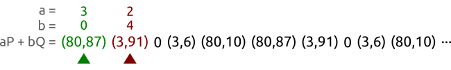

{
  "title": "Elliptic Curve Cryptography: a gentle introduction (4)",
  "date": "2017-06-15",
  "url": "/posts/elliptic-curve-cryptography_a-gentle-introduction_4/",
  "description": "讨论椭圆曲线离散对数问题和相关计算方法。",
  "categories": [
    "工程"
  ],
  "cover": "banners/elliptic-curve-cryptography_a-gentle-introduction_4.webp",
  "tags": [
    "cryptography",
    "ecc",
    "ecdsa"
  ]
}

# 椭圆曲线加密：安全性以及RSA对比

> 原标题：Elliptic Curve Cryptography: breaking security and a comparison with RSA

这篇文章是ECC：优雅入门系列的第四篇文章，我们已经在前面的文章中知道了一个椭圆曲线上的离散对数离散对数问题是如何在保障加密安全的过程中扮演重要角色的。但是，如果你还记得的话，我们曾经提到说目前还没有严格的[数学证明](http://andrea.corbellini.name/2015/05/23/elliptic-curve-cryptography-finite-fields-and-discrete-logarithms/#discrete-logarithm)来证明计算离散对数的复杂性:我们相信这件事情是“困难”的，但是我们并不确定。在这篇文章的开篇，我们将尝试去解释在目前的技术能力下，完成这件事情是多么地“困难”。
然后，在这篇文章的第二部分，我们将尝试去回答这样的问题，为什么我们需要椭圆曲线？RSA（或者其他基于模运算的加密系统）不是也挺好的吗？

## 攻破离散对数问题

我们将会在下文中看到两个最为有效的用来计算椭圆曲线上的离散对数的算法：baby-step,giant-step算法，以及Pollard's方法。

在开始之前，我还是简单提醒一下，所谓的离散对数问题就是**给定两个点P和Q，找到这样的证书x使得满足式子 \(Q = xP\)**。其中的点是椭圆曲线子群中的点，这个椭圆曲线应该拥有基点G和阶n。

### Baby-step,giant-step

在描述这个算法的细节之前，我们先快速地看一下这个问题：我们始终能够写出这样的整数x使得\(x = am+b\)，其中a,m,b是三个任意整数。举例来说，我们可以写出 \(10 = 2\cdot 3+4\)。

根据上面的规则，我们可以给出如下的等式来描述离散对数问题：


$$
Q = xP \ Q = (am +b)P \ Q = amP + bP \ Q - amp = bP
$$


“baby-step,giant-step”其实是一个二分算法。不同于暴力破解( brute-force attack)(通过枚举所有有可能的点xP得到我们需要的Q)，我们可以"稍微"地减少计算量，通过计算bP和Q-amP直到我们找到相似值。这个算法的具体步骤如下：

1. 计算 \(m = \lceil \sqrt{n} \rceil\)
2. 对于所有的\(b\)属于\(0,…,m\)计算\(bP\)并将结果存储到hash表中.
3. 对于所有的\(a\)属于\(0,…,m\):
4. 计算\(amP\)
5. 计算\(Q - amP\)
6. 检查这个hash表并观察是否存在这样的点使得\(Q - amP = bP\)
7. 如果这样的点存在，那么我们就找到了这样的x 满足\(x = am +b\)

就像你看到的一样，我们计算点\(bP\)的时候步进非常小，就像baby走路一样，系数b慢慢增加(\(1P,2P,3P,…\))。然后，在这个算法的第二部分，我们计算\(amP\)的时候步进又很大，因为系数am的变化规律是(\(1mP,2mP,3mP,…\)，其中m是一个大整数)。


> `baby-step,giant-step`算法：通过小步进初始化一些点在hashmap中进行存储，然后我们计算大步进并比较新的点是否在hashmap中能够被找到，计算离散对数相当于是一个重新排序的事情。

为了能够理解这个算法是怎么工作的，首先我们先忘记点\(bP\)是如何缓存的，而是考虑等式 \(Q = amP + bP\)。看看如下的步骤：
- 当\(a=0\)的时候我们看看\(Q\)是否等于\(bP\)，其中\(b\)是\(0\)到\(m\)之间的某个整数。那么在实际上我们就是在比较\(Q\)和\(0P\)到\(mP\)之间是否相等。
- 当\(a = 1\) 时，我们检查\(Q\)是否等于\(mP + bP\)。其中这里的\(Q\)就相当于同 \(mP\)到\(2mP\)之间的值比较。
- 当\(a=2\)我们需要比较\(Q\)和\(2mP\)和\(3mP\)之间的点。
- ...
- 当 \(a = m-1\),我们其实在比较Q同\((n-1)mP\)到\(m^2P = nP\)之间的点。
所以终上所述，我们其实是在检查所有的从\(0P\)变化到\(nP\)的点。（这么多就足够了，这已经是所有的可能情况了）这需要我们计算至多\(2m\)次加法和乘法（包括`baby-step`中的m和`giant-step`中的）。
当然我们知道在hash表中找一个元素需要花费\(O(1)\)的复杂度，所以我们可以轻易地知道，这个算法需要花费的时间和空间复杂度都是\(O(\sqrt{n})\)(或者是\(O(2^{\frac{k}{2}})\))，虽然这还是需要很多时间，但是比穷举是好多了。

### `Baby-step,giant-step`实战

为了能够说明\(O(\sqrt{n})\)是有意义的，我们以标准曲线为例子:`prime192v1`(也叫做`secp192r1`,`ansiX9p192r1`),这个曲线拥有阶数`n = 0xffffffff ffffffff ffffffff 99def836 146bc9b1 b4d22831`。这个数的开根号大约是\(7.922816251426434 \cdot 10^{28}\)。
想象一下为了在hash表中存储\(\sqrt{n}\)个点，假设每个点需要32byte,**我们的hash表大约需要\(2.5\cdot 10^{30}\)byte的内存**，[网上查了一下](http://www.csc.com/big_data/flxwd/83638-big_data_just_beginning_to_explode_interactive_infographic)，将全世界的存储能力加起来以zettabyte（\(10^{21} byte\)）为单位来衡量，我们的hash表需要的存储空间这里还是大约相差10倍左右。就算我们的一个点只需要存储1 byte，还是无法存储这些点。

这非常的令人惊讶，但是更加令人惊讶的是，曲线`prime192v1`几乎是所有曲线中阶数最小的了。`secp521r1`(另一个NIST中规定的标准曲线)阶数大约是\(6.9 \cdot 10^{156}\)。

### 亲自动手实践`baby-step，giant-step`

安装惯例，我写了一个python程序利用`baby-step,giant step`算法计算离散对数。明显这个脚本只对低阶的椭圆曲线有效，如果你想用曲线`secp521r1`那你就等着收到一个`MemoryError`吧。
脚本的输出结果应该如下:

```
Curve: y^2 = (x^3 + 1x - 1) mod 10177
Curve order: 10331
p = (0x1, 0x1)
q = (0x1a28, 0x8fb)
325 * p = q
log(p, q) = 325
Took 105 steps
```

### Pollard's \(\rho\)

Pollard's \(\rho\)是另一个计算离散对数的算法。这个算法和`babe-step,giant-step`算法有相同的复杂度\(O(\sqrt{n})\)，但是它的空间复杂度只有\(O(1)\).如果`baby-step,giant-step`算法因为内存空间限制无法解决的问题，Pollard算法是否能解决呢？

在Pollard算法中，我们将会去解决稍稍不同的问题，给定\(P\)和\(Q\)，找到这样的整数\(a\)，\(b\)，\(A\)和\(B\)满足\(aP+bQ = AP + BQ\)。
一旦这四个整数都被找到了，我们可以用等式\(Q = xP\)来找到这个x:


$$
aP +bQ = AP + BQ \ aP+bxP = AP + BxP \ (a + bx)P = (A+Bx)P \ (a - A)P = (B - b)xP
$$


限制我们可以得到\(P\)的值，但是在计算它的值之前，我们需要重新说明一下，我们的子群是循环的并且具有阶n因此，在计算的时候需要加上模n作为系数：


$$
a -A \equiv (B-b)x (\mod n) \ x = (a-A)(B - b)^{-1} \mod n
$$


Pollard’s \(\rho\)算法的理论其实很简单，我们定义一个**(a,b)的伪随机序列**，这个序列产生的值可以用于产生点\(aP + bQ\)，因为\(P\)和\(Q\)都是同一个循环子群中的元素，所以**产生的一系列点\(aP+bQ\)也是循环的**。

上面的说明的意思就是只要我们遍历我们的伪随机序列\((a,b)\)，早晚我们就会发现这是一个换，所以我们可以肯定一定存在这样的值对\((A，B)\)使得等式\(aP+bQ = AP+BQ\)。
不同的值对代表同一个点，这点就在我们计算对数的时候起到作用。
问题是：我们如何高效地得到这样的环？

### Tortoise and Hare(龟兔赛跑)

为了能够找出我们的换，我们可以尝试所的a和b的可能值，通过[pairing funciton](http://en.wikipedia.org/wiki/Pairing_function),但是这里却有\(n^2\)个可能的值对，那么我们的算法的复杂度就会是 \(O(n^2)\)，比暴力穷举的复杂度还搞。
但是这里还是有稍微快点的算法的：龟兔算法（tortoise and hare algorithm）也叫Floyd's cycle-finding algorithm。下面的图片展示了这个算法是怎么工作的，这就是Pollard's rho算法的核心部分了。

> 我们现在用曲线\(y^2 \equiv x^3 + 2x+3 (\mod 97)\)以及点\(P = (3,6)\)和\(Q = (80,87)\)，这两个点都是属于这个5阶子群的。
> 我们用不同的速度遍历这个值对序列知道我们找到两个不同的值对(a,b)和(A,B)能够得出相同的但。在这个例子我们相同的值对是(3,3)和(2,0)，通过这两个点我们可以算出\(x = (3-2)(0-3)^{-1} \mod 5 =3\),而且这确实是正确的 \( Q = 3P \).

基本地，我们将我们的随机数生成序列得到(a,b)值对，然后计算得到相应的点序列\(aP+bQ\)。这个值对序列可能是也可能不是循环的，但是点序列确实循环的，因为\(P\)和\(Q\)都是由相同的基点产生的，从子群理论中我们知道仅仅在其上用加法和乘法我们是无法“逃出”子群的。

现在我们用两个小动物来做比喻，乌龟和兔子，乌龟和兔子将会找到两个相同的点，但是却是由不同的系数对产生的。更加详细地，乌龟将会找到值对(a,b)而兔子将会找到值对(A,B)，最后会满足\( aP+bQ = AP+BQ \)

如果你的随机数序列是由某种算法（或者就是固定存储的），那么我们就可以简单地退出这个龟兔理论所需要的空间复杂度为 \(O(\log n)\)，然而计算时间复杂度却没有那么简单，但是我们可以通过计算概率的方式得到**时间复杂度就和我们前面说的一样是\(O(\sqrt{n})\)**。

### 与Pollard's \(\rho\)亲密接触

我已经写了一个用于计算Pollard's rho的[python](https://github.com/andreacorbellini/ecc/blob/master/logs/pollardsrho.py)脚本，虽然这个脚本没有完整地实现Pollard's rho算法，但是就是有稍稍的改进（我用了更加高效的随机数生成算法生成值对序列）。这个脚本包含了一些非常有用的注水，如果你对这个算法感兴趣的话，去阅读这些注释吧。
这个脚本和`baby-step, giant step`一样都只能工作在小规模的曲线上，而且和上面的输出结果是一样的。

### 与Pollard's \(\rho\)实战

我们前面说到`baby-step, giant step`算法无法应用到实际当中，因为它需要巨大的内存空间，然而Pollard's rho却不需要那么大的内存空间，那么实际上呢？

Certicom在1988年发起了一项[挑战](https://www.certicom.com/index.php/the-certicom-ecc-challenge)，计算比特位数为109到359的椭圆曲线的离散对数。到今天为止，也只有**109bit长度的曲线**被成功攻破，这次尝试是在2004年发起的，在[维基百科](http://en.wikipedia.org/wiki/Discrete_logarithm_records)上的评论是：

> he prize was awarded on 8 April 2004 to a group of about 2600 people represented by Chris Monico. They also used a version of a parallelized Pollard rho method, taking 17 months of calendar time.

我们已经说过了，`prime192v1`是目前来说“最小”的椭圆曲线了，我们也说过Pollard's rho 的时间复杂度是\(O(\sqrt{n})\),如果我们用Chris Monico相同的技术(相同的算法，在相同的硬件和相同的机器上)，我们需要花多久来计算一次在`prime192v1`上的离散对数呢？


$$
17\ months \times \frac{\sqrt{2^{192}}}{\sqrt{2^{109}}} \approx 5\cdot 10^{13} \  months
$$


这个数字足以在某种程度上说明破解离散对数问题在目前的技术能力上的难度了。

### 对比一下Pollard's rho 和Baby-step giant step算法

我决定将[baby-step giant-step](ttps://github.com/andreacorbellini/ecc/blob/master/logs/babygiantstep.py)和[Pollard's rho](https://github.com/andreacorbellini/ecc/blob/master/logs/pollardsrho.py)一起同[暴力穷举算法](https://github.com/andreacorbellini/ecc/blob/master/logs/bruteforce.py)合在一起放到第[四个脚本](fourth script)中做一个比较，看看它们之间的性能。
第四个脚本会在“小型”曲线上用不同的算法计算所有的点，并报告一共耗时多少：
> Curve order: 10331
> Using bruteforce
> Computing all logarithms: 100.00% done
> Took 2m 31s (5193 steps on average)
> Using babygiantstep
> Computing all logarithms: 100.00% done
> Took 0m 6s (152 steps on average)
> Using pollardsrho
> Computing all logarithms: 100.00% done
> Took 0m 21s (138 steps on average)

正如我们所期待的，暴力穷举同其它两个算法相比就非常地慢，Baby-step giant step算法是最快的，而Pollard's rho算法比Baby-step giant step算法慢三倍（虽然看上去它用的内存空间最小且步数最小）。

当然我们在看看计算步数，暴力穷举平均花费了5193步，非常接近10331/2（曲线阶数的一半），Baby-step和Pollard’s rho花费了152步和138步两个步数都很接近10331的平方根(101.64)。

### 最终结论

我们讨论了很多算法，同时也给出了相当的数据。但是我们一直都有一个问题，就是：算法能够在很多方面加以提升，比如硬件，特殊针对于计算离散对数的硬件也会出现。

实际上在今天提升硬件的方法看上去是不实际的，并不是说这个方法不可行，而是我们又更加好的办法（记住，现在还没有严谨的证明离散对数的复杂性）。

##Shor’s algorithm
如果现在的技术不可行，那么未来的技术呢？好吧，现在有些事变得有些令人担忧：实际上存在一种[量子算法](https://en.wikipedia.org/wiki/Quantum_algorithm)**能够在多项式时间内解出离散对数问题**，这个算法的时间复杂度是O((log\_n)^3)，空间复杂度是\(O(log_n)\)。

之所以量子算法能够有这么高的效率，得益于它的状态叠加。在传统的计算机中，内存单元（例如bit）只有两种状态1或者0，没有中间状态。但是相对的，量子计算机的内存单位（被称为qubit）的状态却是无法被确定的，这同薛定谔的猫理论类似，只要在其被测量的时候才能知道其具体状态，状态叠加并不是说这个qubit可以同时为0和1,而是我们可能发现0也可能发现1。而量子算法就是基于每个qubit的可能性构建的。

其实这隐含了一个qubit的特性，就是我们可以在同一时刻输入多个可能的输入值。举例来说我们可以告诉量子计算机这里有一个数x均匀地分布在0到n-1之间，这仅仅需要\(\log n\)个quebit而不是\(n\log n\)个bit。然后我们可以让量子计算机计算标量乘法得到\(xP\)。结果会在我们给定的0P到(n-1)P之间叠加——也就是说，我们如果现在测量我们的qubit们我们将会得到\(0P\)到\((n-1)P\)之间的某个值，而概率是1/n。

上面的只是让你知道状态叠加的强大力量，，但是Shor’s算法目前还是没有办法实现的，实际上其实更加复杂。其中比较复杂的一点是，当我们能够“模拟”同时有n种状态的时候，我们需要输出的是一个答案而不是一堆答案（即，我们需要知道单一的对数，而不是一堆可能错误的对数）。

## ECC 和RSA

现在让我们忘了该死的量子计算，这个问题目前还不能作为一个严重的问题，现在我们需要讨论的问题是**在RSA还不错的情况下，为什么要用椭圆曲线呢？**

一个由NIST给出的快速答案，它给出了一个[同等安全等级下的密钥大小对比表](https://www.nsa.gov/business/programs/elliptic_curve.shtml)：

| RSA Key size (bits) | ECC key size (bits) |
| --- | --- |
| 1024 | 160 |
| 2048 | 224 |
| 3072 | 256 |
| 7680 | 384 |
| 15360 | 521 |

需要注意的是，RSA的key大小和ECC的key大小并没有相应的线性关系（换句话说，如果我们将RSA的密钥大小加倍，并不能相应地得到双倍的ECC的密钥）。这个表告诉我们ECC不仅仅需要较小的内存，而且公钥的生成和签名更快。
但是为什么是这样的呢？这是因为在椭圆曲线上的计算离散对数的最快的方法就是 Pollard's rho and baby-step giant-step但是在RSA体系下我们却有更加快的算法。一个较为实用的算法是： [general number field sieve](https://en.wikipedia.org/wiki/General_number_field_sieve),一个通过因式分解计算离散对数的算法。general number field sieve是目前整数因式分解最快的算法。

所有基于模运算的加密系统都有相同的问题，包括DSA, D-H 和ElGamal。

## NSA的隐藏威胁

现在我们需要讨论一下更加难的部分。目前我们已经讨论了算法和数学的部分，现在我们讨论一下复杂的人和事。

如果你还记得的话，上一篇文章我们说到有一些椭圆曲线是很脆弱的，为了解决来着可疑来源的曲线的可信任问题，我们加入了一个随机种子到主要参数当中。而且我们可以看到那些NIST的标准曲线都是可验证的随机的。

如果我们阅读维基百科[“nothing up my sleeve”](http://en.wikipedia.org/wiki/Nothi的ng_up_my_sleeve_number)我们可以看到如下内容：

- MD5的随机数是从正弦整数中产生的
- Blowfish的随机数是从\(\pi\)的第一个数字产生的
- RC5的随机数是从\(e\)和黄金比例中产生的
  这些数字都是随机的因为这些数字都是非均匀分布的。这些都是毋庸置疑的，因为这些都是公开的。
  但是现在的问题是：**NIST曲线的随机数是从哪里来的呢？**答案是我们不知道，而且这些随机种子也没有公开。

是否存在这样的可能:**NIST已经发现了一类“足够大的”弱椭圆曲线，并尝试了一些可能的随机种子直到生成一个脆弱的曲线？**我无法回答这个问题，但是这是一个正当的且重要的问题。我们知道NIST成功地规范化了一个[" vulnerable random number generator “](http://en.wikipedia.org/wiki/Dual_EC_DRBG)(一个奇怪的基于椭圆曲线的若随机数生成器)。可能他们也成功地规范化了一组弱椭圆曲线，但是是不是这样我们无从得知。

理解“可信随机”和“安全”是两码事，这个和对数问题的困难程度或者我们的密钥长度无关，如果我们的算法被攻破了，我们几乎什么都做不了。

考虑到这些，RSA是成功的，因为它不需要任何特殊的领域参数，而且这些领域参数也不会被篡改。RSA(和其他的模运算加密系统一样)在我们无法自己生成领域参数且无法信任授权方时，是一个很好的选择。值得一提的是，TLS用的也是椭圆曲线算法，它基于ECDHE和ECDSA算法，证书基于`prime256v1`（也称`secp256p1`）上。

## That's all

我希望你能够喜欢这个系列的文章。我的目标是让你能够对椭圆曲线加密系统有一个基本的了解，知道其术语代表的都是什么意思。如果我达成了我的目标，那么目前依旧能够理解现在的基于ECC的加密系统是怎么工作的，同时你也能够通过阅读一些“不怎么优雅”的文献来加深对这些知识的理解。当我在完成这个系列的文章的时候我跳过了很多细节，用了最简单的术语和知识为了是你能够快速理解。但是我比较担心的是你无法理解网络上的一些较为复杂的术语，我认为这系列的文章能够在简单性和完整性上做到了较好的均衡。

一定要注意仅仅阅读了这系列的文章并不能让你实现一个安全的ECC加密系统：这需要了解很多安全方面的重要细节。还记得[requirements for Smart’s attack](http://andrea.corbellini.name/2015/05/30/elliptic-curve-cryptography-ecdh-and-ecdsa/#random-curves)和[Sony’s mistake](http://andrea.corbellini.name/2015/05/30/elliptic-curve-cryptography-ecdh-and-ecdsa/#ecdsa-k)——这些例子都告诉我们产生一个不安全的算法是多么简单，以及攻破这些算法是多么容易。

所以，如果你对ECC有着更深层次的兴趣，应该去看些什么呢？

首先，我们已经看到了素数域上的Weierstrass curves，但是你必须要知道其他的域和曲线，典型的有：

- Koblitz curves over binary fields. 这些曲线定义在\(y^2 + xy = x^3 ax^2 +1\)()其中a 是0或1),它的有限域包括了\(2^m\)个元素（其中\(m\)是一个素数），这个曲线能够明显地提高加法和乘法的效率，标准的Koblitz曲线有`nistk163`, `nistk283` 和`nistk571` (三个曲线分别定义在 163, 283 和 571 位的域上)。
- Binary curves. 这个曲线和 Koblitz curves 很相似，形如 and are in the form \(x^2+xy=x63+x^2+b\) (其中\(b\) 是一个从随机数). 正如其名，binary curves 被限制到二进制域中。主要的标准曲线有 `nistb163`,`nistb283` 和 `nistb571`。目前有观点认为 Koblitz 和 Binary curves不像 prime curves那么安全。
- Edwards curves, 形如\(x^2+y^2=1+dx^2y^2\) (其中 \(d\) 可以是 0 或 1). 它的特点除了其加法和标量乘法的速度都很快之外，还有它点加的公式都是相同的，在某些情况下可以描述为 \((P≠Q,P=Q, P=−Q, ...)\)。这个特点能够抵御side-channel攻击，这个攻击通过零标量乘法的时间来猜测标量因子。( This feature leverages the possibility of side-channel attacks, where you measure the time used for scalar multiplication and try to guess the scalar coefficient based on the time it took to compute.) Edwards curves 相对来说比较新 ( 2007被发表) 目前还没有权威机构类似于Certicom 或者 NIST对其进行标准化。
- Curve25519 and Ed25519 are two particular elliptic curves 是分别为ECDH和ECDSA专门设计的曲线，就像Edwards curves, 这两个曲线非常地快速，并能够抵御side-channel 攻击。 并且正如 Edwards curves,这两个曲线还没有被正式标准化，我们还不能够在典型的引用中找到他们的身影（除了OpenSSL，它在2014年支持了Ed25519曲线）。

如果你对ECC的实现细节比较感兴趣，我建议你去阅读以下OpenSSL和GnuTLs的源代码。

最后如果你对ECC背后的数学细节感兴趣，而不是安全高效的算法，你需要知道如下知识：

- Elliptic curves are algebraic varieties with genus one.
- Points at infinity are studied in *projective geometry* and can be represented using *homogeneous coordinates* (although most of the features of projective geometry are not needed for elliptic curve cryptography).

以及不要忘记学习**finite fields** 和 **field theory**。

这些就是你需要查询或者你会感兴趣的全部主题了。

现在，这个系列已经官方完结了。
