{
  "title": "PBFT算法关键要点详叙",
  "date": "2021-01-18",
  "url": "/posts/pbft-key-points/",
  "description": "围绕节点角色、消息阶段和视图变更，梳理 PBFT 的工作过程。",
  "categories": [
    "系统"
  ],
  "cover": "banners/pbft-key-points.webp",
  "tags": [
    "共识",
    "区块链"
  ]
}

## 引言 {#引言}

在一个分布式系统当中，如果需要提供可靠服务，数据操作（读写）的冗余是必要的。假设现在我们有一个分布式数据库集群，其中的服务器节点会相互同步数据。一种简单的思维，如果网络正常，服务器稳定，一切顺利，我们只需要把数据写入其中一台服务器，集群中的所有服务器就都会同步到写入的数据。但事情往往没有这么简单，实际上这台写入的服务器可能会宕机、断网，甚至代码也会有bug，这些问题都有可能导致数据同步失败，之前的写入操作实际上有可能是失败的，所有服务器无法同步到数据。同样地，如果写入成功，我们随便挑一台服务器读取数据就没有问题了吗？如果这台服务器同步速度慢一些，那么我们读取的值也是不对的。那么，如果我们在写入的时候多写如几台服务器不就好了，一种极端思维是我写入所有服务器，这样当然所有服务器上的数据都是最新的；在读取的时候我们也可以读所有服务器，这样一定能够读到最新的数据，但是这样显然很耗费资源，我们能不能读写一部分也能够得到确定的最新结果呢，如果可以的话，读写多少服务器比较合适呢？

这个服务器数量，就是所谓的 `quorum`，一般来讲，在写入数据的时候，只需要达到 `quorum` 台服务器，我们就可以认为写入成功，同样地，在读取数据的时候，只需要读取 `quorum` 台服务器，就可以认为读取的结果是正确的，并且是最新的。

显然这个`quorum`值是取决于分布式集群所有服务器的数量的，全网服务器数量越多，`quorum` 越大，当然，如果 `quorum` 越大，那么需要操作的服务器数量就越多，操作开销也越大。

那么，`quorum` 多大比较合适呢？

在集群的数据同步过程当中，存在几种情况：

一是并发操作，就是多人同时操作数据集群，如果有两个人进行写入操作，比如 Alice写入 `A = 2`， 同时 Bob 写入 `A =3` ，如果一半服务器接受 `A=3`，而另一半接受 `A=4` 是不行的，这就出现了集群脑裂的情况，为了避免这个情况，要求我们至少写入集群中的多数节点。

另一种是非串行化读写，如果我们在写入数据的完成之后，用户立即来读取数据了，但是恰好用户读取的服务器还没有同步到最新数据，用户读的数据是过时的，这样也是不对的，我们应该保证，写入成功之后，读取的值应该是上次写入之后的结果，所以我们至少要读到一个写入操作过的节点。

那么写入操作和读取操作至少都需要多少个节点才能保证上述情况不会发生呢？问题将会在下文中揭晓。

## Prerequisite {#prerequisite}

### 共识问题 (Consensus Problem) {#共识问题-consensus-problem}

分布式系统的共识问题（Consensus Problem）是指寻找一种协议，使得该协 议满足以下三大属性：

1. 一致性（Agreement）：所有的非缺陷进程都必须同意一个值；
2. 正确性（Validity）：所有非缺陷进程所同意的值必须来之非故障进程所提案的值；
3. 可结束性（Termination）：每个非缺陷的进程必须最终确定一个值。

通常也把一致性和正确性合称安全性（Safety），把可结束性称为活性 （Liveness），而在分布式系统的算法和设计中， 安全性和活性是两个非常重要的属性，更通俗地讲，这两个属性的另一种解释是：

- **安全性 (Safety)** ：错误的值永远不会被采用（something “bad” will never happen）；
- **活性 (Liveness)** ：最终正确的值将会被确定并同意，但是无法确定时间 （ something “good” will must happen, but we don’t know when）

也可通俗解释为：

- 活性 (Liveness) 就是集群能够确定一个值，通常来讲就是少数服从多数；
- 安全性 (Safety) 就是集群能够确定的值是正确值，而不是错误值。

### 错误类型与错误容忍(Fault Tolerance) {#错误类型与错误容忍fault-tolerance}

错误容忍指的是一个系统在其的某些部件出现错误之后依旧能够继续正常工作，这种能力叫做错误容忍。

在分布式系统当中可能出现的错误主要有两种：

- CF (Crash Fault)：宕机故障，系统中的某些节点可能出现宕机故障，不会响应请求，但是不会恶意响应；
- BF (Byzantine Fault): 拜占庭故障，系统中的某些节点可能出现拜占庭故障，可能会不响应请求，也可能错误响应请求；

> 出现拜占庭故障的节点我们称为拜占庭节点。

- 能够容忍宕机故障的系统我们称为CFT（Crash Fault Tolerance）系统
- 能够容忍拜占庭故障的系统我们称为BFT（Crash Fault Tolerance）系统

### FLP不可能结论 {#flp不可能结论}

分布式系统理论中最重要的结果之一是由Fischer，Lynch和Patterson于1985年4月发表的短篇论文" [Impossibility of Distributed Consensus with One Faulty Process’](http://cs-www.cs.yale.edu/homes/arvind/cs425/doc/fischer.pdf)，该论文最终确定了异步环境中分布式过程可以实现的目标的上限，并获得了分布式计算领域最有影响力论文的Dijkstra奖。

这个论文的结论称为“ FLP不可能结论”，解决了过去五到十年在分布式理论研究中一直存在的争议。众所周知，共识问题在同步系统中可以解决。非正式描述为，同步模型通过等待一个完整的步长等待来自处理器的答复，并假设如果未收到答复而崩溃，则可以检测到故障。

在异步系统中，这种故障检测是不可能的，在异步设置中，处理器完成工作然后响应消息所花费的时间没有限制。因此，无法确定处理器是否崩溃还是花费了很长时间进行响应。

FLP结论表明，在异步系统中，如果有一个进程可能出现崩溃，则没有解决共识问题的分布式算法。

> 科学告诉我们什么是不可能的；工程则告诉我们，可以付出一些代价，将不可能变成可行。

### Quorum机制 (Quorum intersection) {#quorum机制-quorum-intersection}

Quorum 机制，是一种分布式系统中常用的，用来保证数据冗余和最终一致性的投票算法，其主要数学思想来源于鸽巢原理。Quorum 系统可以定义为一组集合（称为 Quorum 集合）这组集合满足一定的相交属性。在有冗余数据的分布式存储系统当中，冗余数据对象会在不同的机器之间存放多份拷贝。但是同一时刻一个数据对象的多份拷贝只能用于读或者用于写。

在分布式系统中，冗余数据是保证可靠性的手段，因此冗余数据的一致性维护就非常重要。一般而言，一个写操作必须要对所有的冗余数据都更新完成了，才能称为成功结束。比如一份数据在5台设备上有冗余，因为不知道读数据会落在哪一台设备上，那么一次写操作，必须5台设备都更新完成，写操作才能返回。对于写操作比较频繁的系统，这个操作的瓶颈非常大。

Quorum算法可以让写操作只要写完3台就返回。剩下的由系统内部缓慢同步完成。而读操作，则需要也至少读3台，才能保证至少可以读到一个最新的数据。

分布式系统中的每一份数据拷贝对象都被赋予一票。每一个读操作获得的票数必须大于最小读票数（read quorum）（\(V_r\)），每个写操作获得的票数必须大于最小写票数（write quorum）(\(V_w\)）才能读或者写。如果系统有\(V\)票（意味着一个数据对象有\(V\)份冗余拷贝），那么最小读写票数(quorum)应满足如下限制：

1. \(V_r + V_w > V\)
2. \(V_w > \frac{V}{2}\)

第一条规则保证了一个数据不会被同时读写。当一个写操作请求过来的时候，它必须要获得\(V_w\)个冗余拷贝的许可。而剩下的数量是\(V-V_w\) 不够\(V_r\)，因此不能再有读请求过来了。同理，当读请求已经获得了\(V_r\)个冗余拷贝的许可时，写请求就无法获得许可了。

第二条规则保证了数据的串行化修改。一份数据的冗余拷贝不可能同时被两个写请求修改。

Quorum的读写最小票数可以用来做为系统在读、写性能方面的一个可调节参数。写票数\(V_w\)越大，则读票数\(V_r\)越小，这时候系统读的开销就小。反之则写的开销就小。

再以一个分布式系统为例，系统中有 N 个服务器，客户端需要从这个分布式系统中进行写入并读取数据，我们将写入操作定义为\(OP_w\) ，被写入的服务器集合为\(Q_w\) ，将读取操作定义为\(OP_r\) ，被读取的服务器集合为\(Q_r\) ，假设故障的节点集合 \(F\)。

Quorum 要求系统达到如下要求：

$$
Q_w \cap   Q_r \neq \emptyset
$$

$$
Q_w - F \neq \emptyset
$$

$$
Q_r - F = \emptyset
$$

$$
\vert{Q_w}\vert + \vert Q_r \vert > \vert N \vert
$$

$$
\vert Q_w \vert > \frac{\vert N \vert}{2}
$$

- 公式 (1) 说明了系统当中的多数原则，在写入和读取的成员应当是有交集 的，这样才能够保证读取到写入的正确值
- 公式 (2)、(3)说明了在读取和写入的过程当中至少成功操作一个正常服务器
- 公式 (4) 说明了多数原则的数量关系
- 公式 (5) 说明了串行化原则，一个系统不能同时进行两个不同的写入操作，交集属性确保任何读取操作都可以访问已写入的最新值，能够保证读写操作的正确性。

## 共识算法类型 {#共识算法类型}

以下图片来自[区块链共识算法的发展现状与展望](http://www.aas.net.cn/article/doi/10.16383/j.aas.2018.c180268)

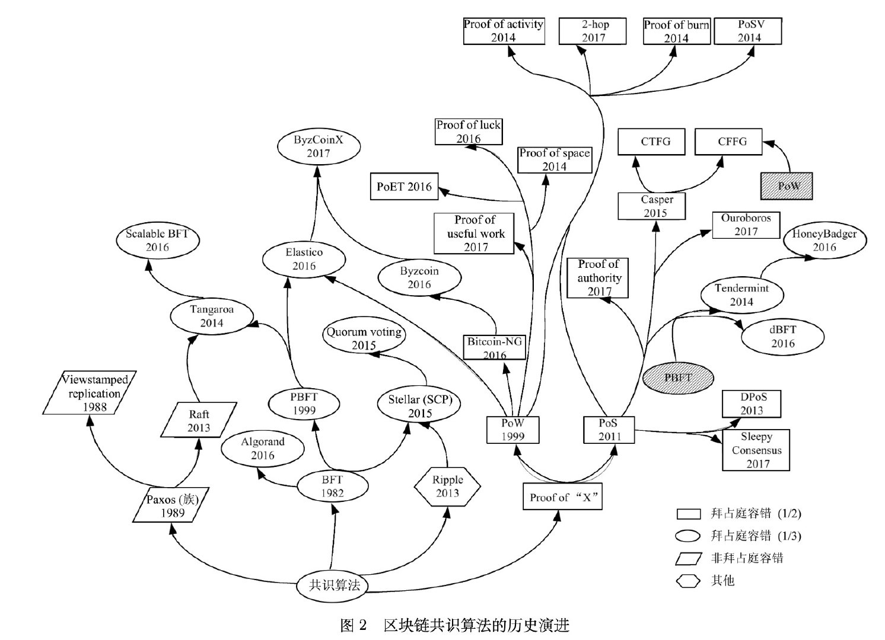
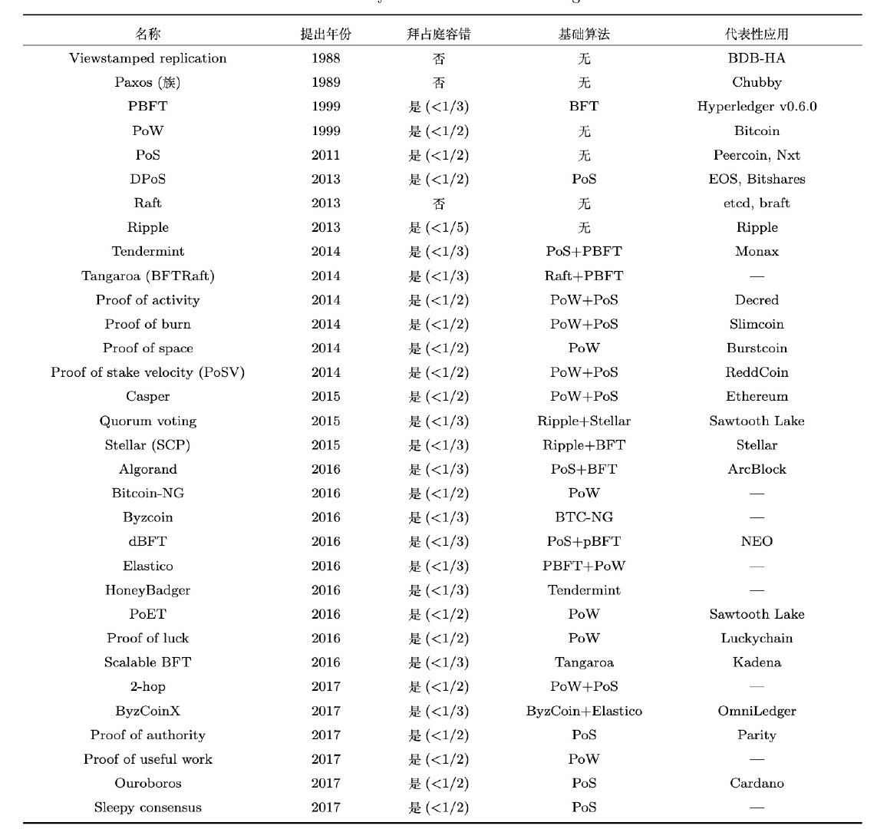

## PBFT 共识算法 {#pbft-共识算法}

PBFT 是 Practical Byzantine Fault Tolerance 的缩写，意为实用拜占庭容错算法。

该算法首次将拜占庭容错算法复杂度从指数级降低到了多项式级，其可以在恶意节点不高于总数 1/3 的情况下同时保证安全性（Safety）和活性（Liveness）。

## 术语与变量 {#术语与变量}

### 约定变量 {#约定变量}

- 集群数量定义为 \(N\)，其数量定义为 \(|N| = n\)
- 拜占庭或者是宕机节点集合为定义为 \(F\)，其数量定义为 \(|F| = f\)
- \( quorum\) 法定成员集合\(Q\)，即每次访问的节点数量\(|Q|\)

### 术语 {#术语}

- **Primary**: 主节点
- **Replica**: 副本节点
- **Client**: 客户端，用于向共识集群发送消息，请求共识
- **View**: 视图，Primary和replica共同达成的一个状态视图，所有节点都基于某个视图进行共识
- **Sequence Number**：序列号，由主节点生成的序列号，用于标识共识轮次

- **Check Point**: 检查点，如果某个序列号被确认，则成为检查点
- **Stable checkpoint**: 稳定检查点，该检查点通常会被持久化

### 推定变量 {#推定变量}

---

> 在撰写本小节的时候，阅读了很多博客和文章，很多解释都模棱两可，没有真正讲清楚，笔者也尝试来解释一下 3f + 1的问题。

引言中我们抛出了一个问题，在分布式系统中需要读写多少台节点才可以满足正确性要求，即`quorum` 的值为多少比较合适？

`quorum` 的值是根据不同的情形需要单独处理的，简单而言，在CFT系统当中，只需要达到`2f + 1`就可以了，因为每次操作都已经达到多数，不管读写我们都能够达成，满足 Quorum intersection 的要求。

但是在BFT系统中，则不一样，下文将进行分析。

> 在BFT中，是允许同时存在故障节点和拜占庭节点的，所以才要求 `3f+1`，如果只允许拜占庭节点存在的话，其实 `2f+1` 也是可以满足要求的。

在一个由 \(N\) 个节点组成的共识网络中，RBFT 最多能容忍\(f\)个节点的拜占庭错误，其中：

$$
f=\lfloor \frac{N−1}{3} \rfloor
$$

而能够保证达成共识的节点个数为：

$$
quorum=\lceil \frac{N+f+1}{2}\rceil
$$

那么这些值都是如何确定的呢？

已知节点集合为 \(N\), 拜占庭错失效节点集合为 \(F\)， 宕机或者是未访问的节点集合为 \(X\) ，访问的最小节点集合(\(quorum\))为\(Q\)。

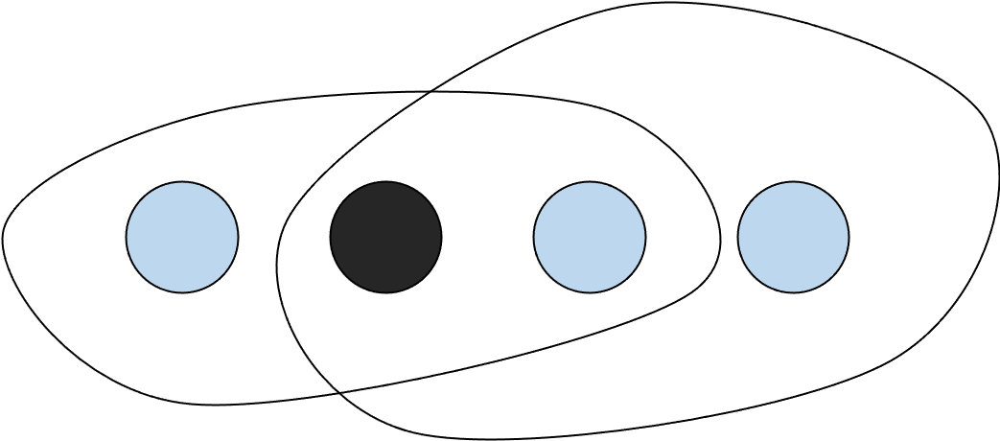
> 以上图为例，quorum = 3, 即一个黑色框选的范围，黑色框未框选的节点可能是有效节点，也可能是无效节点（黑色节点）。未框选的部分为\(X\)。

（1） Liveness, 活性要求。整个系统需要能够确定一个值。

可以这么理解，为了能够获取一个值，最极端的方式就是访问所有节点\(N\)， 这是 \(Q\) 的上届，当然我们的目标是尽量减少访问的数量，降低开销，减少多少访问的数量比较合适呢？已经知道了有\(|F|\)个节点是拜占庭节点，活性要求能够拿到一个值，而这\(|F|\)个节点可能都不响应，所以我们至多可以访问 \(|N| - |F|\)个节点，至少需要访问\(|F| + 1\)个节点，才能够拿到最终结果。

所以我们有：

$$
|N| - |F| \geq |Q| \geq |F| + 1
$$

> 如果我们访问的|Q|个节点都是宕机节点，其下界可以保证我们一定能够得到一个结果；而其上界则缩小了其能够访问的节点数量上限，虽然我们依旧可以访问\(|N|\)个节点，但是可以确定的是其中\(|F|\)次访问是没有意义的。
>
> 但是这个时候如果访问的这 \(|N| -|F|\)个节点恰好都是拜占庭节点呢？我们也不知道哪些节点是拜占庭节点，这个问题是下面的“安全性”要求需要解决的。

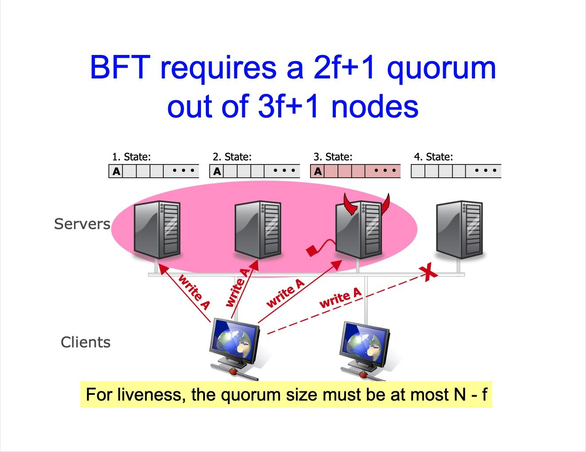

（2）Safety,安全性要求。已知拜占庭节点和正常节点一样发送消息，但是会发送错误的消息误导。

一般来讲，在访问集群的时候是有两个过程的，一个是写(w)过程，一个是读(r)过程，经过了两次交互，每次交互的节点集群子集是不一定相同的，我们把第一次写过程访问的集群称为\(Q_w\)，把第二次读过程访问的集群称为\(Q_r\)。

实际上我们无法确定写操作的响应节点集群\(Q_w\)和读操作的响应节点集群\(Q_r\)是否是同一组。所以在上述基础上，要求读写集群需要有交集（quorum intersection），即 \(|Q_w \cap Q_r| \neq \emptyset\)。只有这样，我们才能够读到正确的写入的结果。 但是如果交集正好都是拜占庭节点的话那就被完美骗过了（读过程和写过程都信任了拜占庭节点），所以，又要求 \(|Q_w \cap Q_r| > f\) ，即读写集合数量都至少要比\(f\)大，那么我们可以得到 \(|Q_w \cap Q_r| = (|N|-|F|) + (|N|-|F|) - |N| > |F|\) ，因为节点是整数，所以有:

$$
(|N|-|F|) + (|N|-|F|) - |N| \geq |F| + 1
$$

$$
\Rightarrow |N| \geq 3|F| + 1
$$

所以我们能够得到 \(f = ⌊\frac{n-1}{3}⌋\)，此时能够确定的 \(quorum = |Q| = n-f \geq 2f + 1 \)

可以简单推出:

$$
quorum \geq \lceil \frac{N+f+1}{2} \rceil
$$

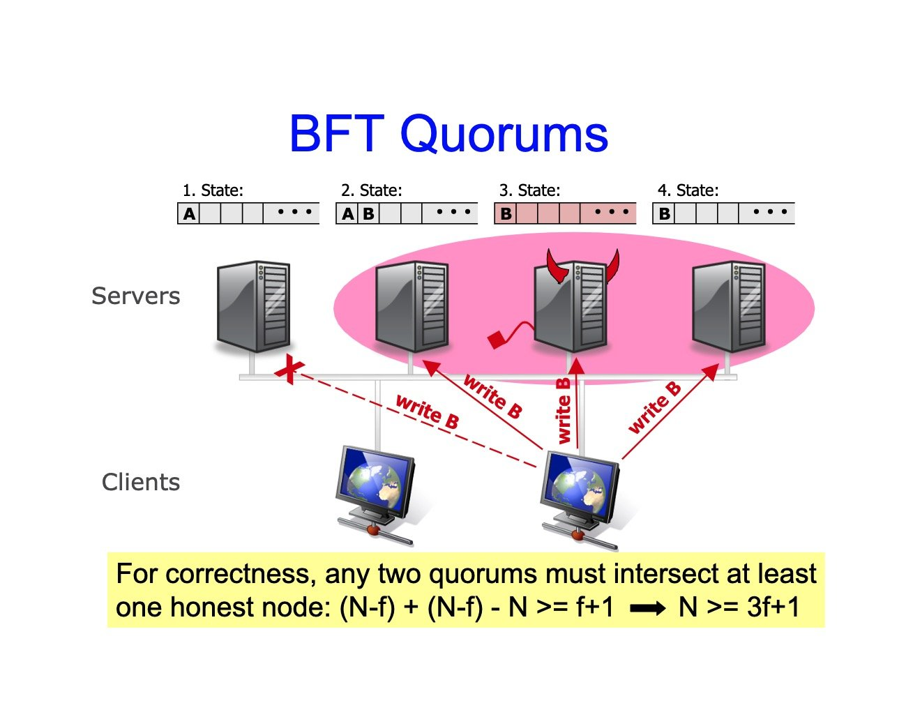
> `3f+1` 的一种解释：
>
> 节点总数是`n`，其中作恶节点有`f`，那么剩下的正确节点为`n- f`，意味着只要收到`n - f`个消息就能做出决定，但是这`n - f`个消息有可能有`f`个是由作恶节点冒充的，那么正确的消息就是`n-f-f`个，为了多数一致，正确消息必须占多数，也就是 `n - f - f > f` 但是节点必须是整数个，所以 `n` 最少是 `3f+1` 个。

笔者认为上述解释是有问题的，首先作恶节点有`f`个，剩下的正确节点有`n-f`个，但是并不意味着收到 `n-f`个消息就能做出决定，我可以收到 `f+1` 个消息就可以做出一种决定，诚然 `f+1` 个消息有可能有`f`个都是错误的，实际可能无法确定结果，所以可以调整为收到 `2f + 1` 个消息确定结果,因为 `f + f + 1` 个消息肯定有 `f+1`个消息是诚实节点发出的，并且为多数，但也没有说明这是最小值；`2f + 1` 即前面讨论的`quorum`，但是 `quorum`与 `N - f`的关系也其实是没有讲清楚的，因为 `2f + 1` 可以等于 `N` ，也可以等于`N-1`等等，综上，其实这种解释不够严谨，但是比较好理解。

> `3f+1`的另一种解释：
>
> 对于 pbft 算法，因为 pbft 算法的除了需要支持容错故障节点之外，还需要支持容错作恶节点。假设集群节点数为 `N`，有问题的节点为 `f`。有问题的节点中，可以既是故障节点，也可以是作恶节点，或者只是故障节点或者只是作恶节点。那么会产生以下两种极端情况：
>
> 1. 第一种情况，`f` 个有问题节点既是故障节点，又是作恶节点，那么根据小数服从多数的原则，集群里正常节点只需要比 `f` 个节点再多一个节点，即 `f+1` 个节点，确节点的数量就会比故障节点数量多，那么集群就能达成共识。也就是说这种情况支持的最大容错节点数量是 `（n-1）/2`。
> 2. 第二种情况，故障节点和作恶节点都是不同的节点。那么就会有 `f` 个问题节点和 `f` 个故障节点，当发现节点是问题节点后，会被集群排除在外，剩下 `f` 个故障节点，那么根据小数服从多数的原则，集群里正常节点只需要比 `f` 个节点再多一个节点，即 `f+1` 个节点，正确节点的数量就会比故障节点数量多，那么集群就能达成共识。所以，所有类型的节点数量加起来就是 `f+1` 个正确节点，`f` 个故障节点和 `f` 个问题节点，即 `3f+1=n`。

这种解释，第一种情况是没有问题的，很好理解，但是在第二种情况中，故障节点和作恶节点是否加在一起是“有问题节点”这个点其实有点混乱了，按照第二种解释的说法，故障节点和作恶节点都有`f`个，那当然很容易就推出来需要`f+1`个节点正常，`N= 3f+1`，但其实应该是，故障节点和作恶节点总共加起来一共 `f` 个，这种解释其实举个例子就可以说明了，假设我们现在一共有4个节点，其中一个是拜占庭节点，一个是宕机节点，集群中只有两个节点可以正常工作，其实整个算法运行不起来的。

## PBFT 主要思想 {#pbft-主要思想}

PBFT 的主要思想其实是：

1. 将节点数量固定（3f +1）
2. 通过三阶段来处理恶意主节点
3. 通过更大的quorum集合来解决共识失效
4. 通过授权通信（消息签名）解决消息认证问题

## 常规流程 normal-case {#常规流程-normal-case}

### 初始定义 {#初始定义}

- `i` : 节点ID (replica id) ，应该是在 \([0, N-1]\) 范围内的值
- `v#` : 视图编号(view number), 初始为零，用 `v#` 表示
- `Primary` : 主节点，通常采用模运算取得: `Primary = v# mod N​`
- `log` : 操作日志， 通常记录了当前收到的消息,形式为 `<v#, seq#, status, d>`
  - `seq#` 为 sequence number
  - `status` 为 `pre-prepared` 、`prepared`或者是`committed`
  - `m` 即本轮共识的具体操作，可以是数据库操作，也可以是区块写入操作
- `d(m)` ，是`m`的密码学摘要信息 (digest)

### 标准算法流程 {#标准算法流程}

**算法示意图**

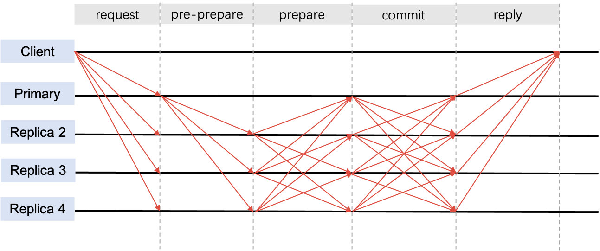

BFT算法主要流程

原论文(osdi99)中是要求客户端直接把请求发送给主节点的，我觉得可以辩证理解，有可能此时这个主节点有问题，需要切换主节点，这个过程客户端感知是比较滞后的，略有缺陷，所以我选了一张更加合适的图作为示意。原论文当中的示意图：

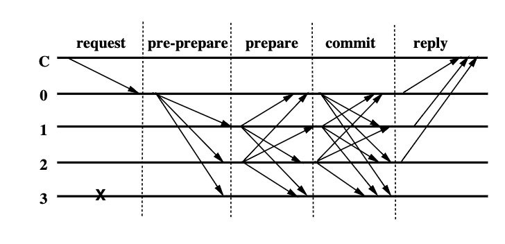

BFT算法主要流程 (osdi99)

**算法核心过程（正常流程）**

- **STEP 1**: 客户端发送请求给主节点（或者发给所有节点），图示是发给所有节点的。之后主节点将会触发三阶段协议，但是这里有一个优化，节点可以先把请求缓存起来，等到攒够一堆请求之后再一起发送，这样可以降低网络开销和系统负载，这个优化是可选的。
- **STEP 2**: 主节点发送 `pre-prepare`消息给所有节点

  - 主节点广播消息形式为 `<<PRE-PREPARE, v#, seq#, d, sig>, m>(p)`，其中`(p)` 表示由主节点发出, `d`是当前消息摘要，`m`为原始消息, `sig` 为`d`的数字签名
  - 主节点将上述的广播消息存储在本地日志中，并标记本节点为 `pre-prepared`状态
  - 注意，主节点也有可能是恶意节点，可能出现如下异常
    - 针对同一个 `d` 发送不同的 `seq#` 给不同的从节点
    - 发送重复的 `seq#`
- **STEP 3**: 从节点检查主节点发送的 `pre-prepare`消息，并进行验证

  - 验证过程包括：
    - 消息中的数字签名`sig`是否合法
    - 是否在同一个`v#`
    - 是否有接收到过一个拥有相同`v#`和`seq#`但`d`是不同的历史消息
    - `seq#`是否在水位线`H`和`h`之间
    - 水位线是为了防止一个异常主节点快速消耗`seq#`空间而设置的，当然还有别的用途
  - 记录上述操作到日志中，标记本节点为 `pre-prepared`状态
  - 发送 `prepare`消息给所以偶节点
  - `prepare`消息的形式为`<PREPARE, v#, seq#, d, i,>(i)` 其中`(i)` 标识从`i`节点发出
  - 主节点将上述的广播消息存储在本地日志中
  - 该过程需要所有节点相互广播
- **STEP 4**: 所有节点接收并匹配所有的 `prepare`消息，并进行处理：

  - 每个节点达到 `prepared(m, v#, seq#, i)`需要满足如下条件：

    - 拥有一个 操作请求 `m`
    - 拥有一个 `pre-prepare` ，其view为 `v#` 下并且其sequence是 `seq#`
    - 以及 `2f` 个从其他节点收到的`prepare`消息，对应前面的`pre-prepare`消息（通过检查其 view 是否相同，sequence是否箱体以及digest 是否相同)，加上自己的消息就达到`2f+1`了
  - 达成上述条件之后，标记本节点为 `prepared(m, v#, seq#, i)`状态
  - 达成`prepared(m, v#, seq#, i)`状态之后，各个节点发送 `commit` 消息给所有节点
  - `commit`消息形式为 `<COMMIT, v#, seq#, D(m), i>(i)`
  - 此时节点已经能够确认所有的诚实节点已经准备好提交相同的值了
  - 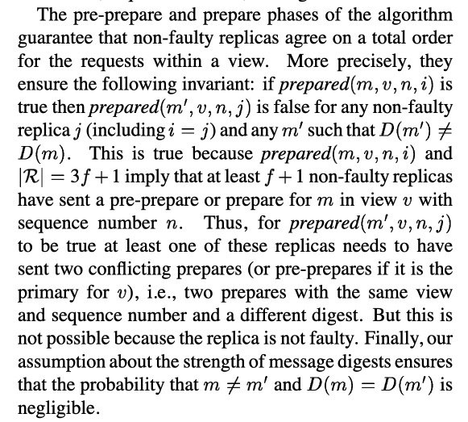
  - prepared 状态证明
  - 上图解释了为什么能够确定诚实节点已经准备好了，其中的 `v` = `v#`， `n` = `seq#`
- **STEP 5**: 所有节点接收所有的 `commit`消息，并进行处理

  - 首先将收到的`commit`消息写入日志，其次要求这些消息是处于水位线 `h`和`H`之间的
  - 原论文中还定义了 `committed(m,v#,seq#)` 以及 `committed-local(m,v#,seq#,i)`这两种状态 ，前面是全网状态，后面是本地节点状态，全网状态在工程实践中用处不大， 因为我们没有办法站在上帝视角去观察，所以只需要研究`committed-local`即可，原文这么写可能是为了学术上的要求。
  - 要达成`committed-local`状态需要满足以下条件：

    - 当前节点已经达成`prepared(m, v#,seq#,i)`状态
    - 并且本节点已经收到了 `2f + 1`个`commit`消息 (可以包括自己的)
    - 上述收到的 `commit`消息需要与前面的prepared状态保持对应，即相同的 `view`, `seq` 以及 `digest` 等
  - 达成 `commit-local(m, v#, seq#, i)`之后，将会按照`m`中的请求顺序进行执行，当然执行和共识可能是异步的，所以需要从低的`seq#` 开始执行
  - 执行完成之后，所有节点将发送结果给到客户端
- **STEP 6**: 客户端收到超过`2f+1`的一致消息则确认当前结果成功

整个过程不需要要求所有的消息是有序到达的，因为`seq#`会保证顺序，只需要对应的`pre-prepare`， `prepare`和`commit`消息都是完整的即可。

### 数据结构 {#数据结构}

#### State状态数据 {#state状态数据}

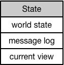

节点的状态主要包含三部分：

- 世界状态，包括已经处理过的交易
- 消息日志
- 当前 view

#### Three Phase Protocol {#three-phase-protocol}

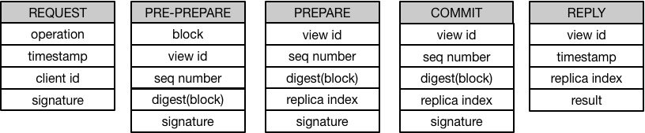

这里列出了三阶段协议相关的消息结构，其中 PRE-PREPARE 消息包含新生成的区块，其他消息则主要包含一些 id、sequence number、区块内容摘要和签名等信息。

### 一种优化流程 {#一种优化流程}

> 以下是基于公开资料收集的 Hyperchain 优化之后的RBFT算法

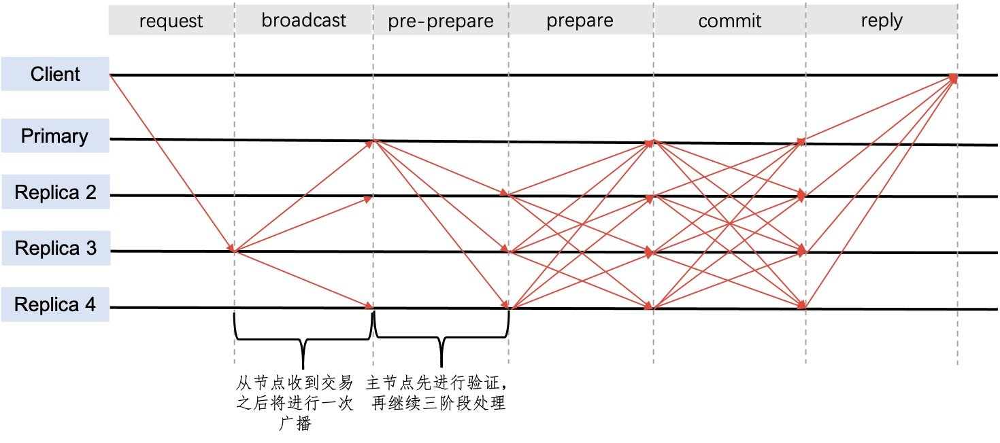

RBFT 做的优化之一是，客户端发送请求到任意节点，如果这个节点不是主节点的话，将会进行一次广播。

优化之二是，主节点收到交易之后会进行验证，并把验证结果放在`pre-prepare`中进行再全网广播，`pre-prepare`是以区块为单位处理的，这样的 `pre-prepare` 消息中既包含了排好序的交易信息也包含了区块验证结果。

从节点在收到主节点的 `pre-prepare` 消息后先检查消息的合法性，检查通过后广播 `prepare` 消息表明本节点同意主节点的排序结果；在收到 `quorum-1` (即`2f` )个 `prepare` 消息后从节点才会开始验证区块，并将验证结果与主节点的验证结果进行比对，比对结果一致则广播 `commit` 表明本节点同意主节点的验证结果，否则直接发起 `view-change` 表明本节点认为主节点有异常行为。

RBFT 常规流程具体分为如下几个步骤：

- \*\*交易转发阶段：\*\*客户端将交易发送到区块链中的任意节点（包括共识节点与记账节点），其中记账节点在收到交易后会主动转发给与其相连的共识节点；而共识节点在收到客户端的交易后将其广播给其他共识节点，这样所有共识节点的交易池中都会维护一份完整的交易列表；

> 共识节点就是参与RBFT共识过程的节点，记账节点是不参与共识，只接受结果并写入区块的节点

- \*\*PrePrepare 阶段：\*\*主节点按照如下策略进行打包：用户可以根据需求自定义打包的超时时间（batch timeout）与打包的最大区块大小（batch size），主节点在超时时间内收集到了足够多（超过最大区块大小个数）的交易或者超时时间到达后仍未收集到足够多的交易都会触发主节点的打包事件。主节点将交易按照接收的时间顺序打包成块，并进行验证，计算执行结果，最后将定序好的交易信息连同验证结果等写入 `pre-prepare` 消息中广播给所有共识节点，开始三阶段处理流程；
- **Prepare 阶段：** 从节点在收到主节点的 `pre-prepare` 消息后，首先进行消息合法性检查，检查当前的视图与序列号号等信息，检查通过后向共识节点广播 `prepare` 消息；
- \*\*Commit 阶段：\*\*从节点在收到`quorum-1` 即(`2f`) 个`prepare` 消息以及相应的 `pre-prepare` 消息后进行验证，并将验证结果与主节点写入`pre-prepare` 消息中的验证结果进行比对，比对结果一致则广播 `commit` 表明本节点同意主节点的验证结果，否则直接发起 `view-change` 表明本节点认为主节点存在异常行为，需要切换主节点；
- \*\*写入账本：\*\*所有共识节点在收到 quorum 个 `commit` 消息后将执行结果写入本地账本。

### 检查点机制与垃圾回收 {#检查点机制与垃圾回收}

在上述过程当中，整体流程每个阶段都写入了日志，基本上每一轮都会产生很多日志缓存；如此下去明显系统存储是不够用的，为了解决上述问题，PBFT引入了垃圾回收（GC）机制，通过检查点 (checkpoint)来进行垃圾回收。

共识过程中的日志`log`需要一直保存在节点中，一直到这个日志状态已经被至少 `f+1` 个非拜占庭副本节点处理过了，并且在view-change过程当中需要能够将这个已经处理过的日志证明给其他节点。

进一步地，还有一种情况是，如果一些副本节点因为某些原因落后了，但是其他非拜占庭节点已经把一些消息都清除了，落后的节点无法通过日志跟上，只能通过直接同步状态跟上，其他节点也需要证明上述状态是合法的。

当然生成这样的证明的成本是高昂的，所以我们不需要每个区块都生成一次，通常来说周期性生成一次比较好，一般来说这个周期间隔是固定的（比如每100个 `seq#` ） ，当共识轮次能够被100整除时，将会生成一个检查点(checkpoint)，经过共识确认的检查点被称为稳定检查点`stable checkpoint`，当然稳定检查点需要带有至少`2f+1`个节点签名，即所谓的proof。生成稳定检查点之后，就可以清除该检查点之前的消息缓存，实现GC。

**检查点生成过程**

当一个 replica `i`生成了一个检查点，将会封装并广播消息 `<CHECKPOINT, seq#, d(state), i>`，所有的备份节点收到了`2f+1`个拥有相同的 `d(state)`的检查点消息（包括自己的消息），将会生成稳定检查点，而 `2f+1`个检查点消息即稳定检查点证明`proof`。 其中`d(state)`是当前状态摘要信息。

当稳定检查点生成之后，将会删除稳定检查点之前的 `pre-prepare`、`prepare`、`commit`消息，当然也会删掉更早的检查点消息。

**状态摘要机制**

状态摘要可以通过增量哈希实现，减少计算量。

**水位线机制**

水位线机制用于限制哪些范围的消息可以被接受。水位线包括低水位线(low-water mark) `h`和高水位线(high water mark) `H = h + k`。

通常来讲，低水位线是最近的一个稳定检查点的`seq#`，而高水位线需要在低水位线上加上一个常量`k`, 常量 `k` 需要足够大，避免共识一致需要等检查点稳定，但是又不能让共识过程跑太远，避免稳定检查点生成失败后大量共识过程需要重做。

水位线机制一方面是为了限制序号空间，另一方面是为了让检查点生成的时候不阻塞共识过程，但又不至于共识过程跑得太快，检查点生成太慢，如果一直领先很多，检查点就没有意义了。

## 视图变更流程 view-change {#视图变更流程-view-change}

### 标准VC流程 {#标准vc流程}

视图变更时为了保证系统能够有一定的活性`liveness`，避免在主节点出现问题的时候无法恢复。

view-change 通常是由超时机制触发的，这个超时定时器一般是系统处理交易伊始就设置的，当系统不再接受交易了。就不需要设置这个定时器。

> 当然在工程上，如果一直设置和取消定时器是很麻烦的，所以，一般来说会一直启用定时器，并通过主节点心跳机制刷新定时器时间。
>
> 论文原话是定时器是为了避免从节点长时间的等待请求，这个需要结合`pre-prepare`进行说明，在通常情况下，主节点将会发送`pre-prepare` 来正常进行共识，从节点也可以通过该消息确认主节点是否存活，因此如果超过一段时间没有收到 `pre-prepare`的话就会认为该主节点有问题了。但是在工程上或者在实际运行当中，长时间没有`pre-prepare`是常见的，因此一般会通过心跳来进行探测保活，所以也不一定非得要用定时器。

当这个定时器是设置在`v#`的，如果它超时了，将会触发 view change，然后把 view 设置为 `v#+1`，此时将停止接受消息（只接受三种消息: `CHECKPOINT`, `VIEW-CHANGE`,`NEW-VIEW` ）

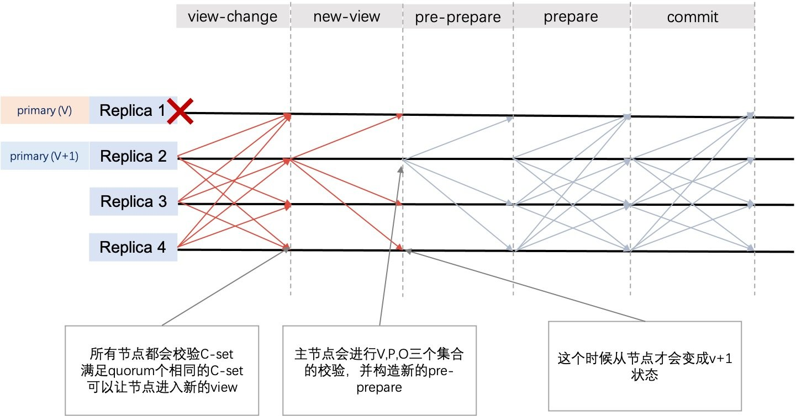

当定时器超时，系统将会广播 `<VIEW-CHANGE, v#+1, seq#(stable_checkpoint), C-set, P-set,i>(i)`, 其中：

- `(i)`标识由节点`i`发出
- `seq#(stable_checkpoint)`是上一次稳定检查点的 sequence（对于节点`i`而言，其他节点的未必一致）
- `C`是 `2f+1`个能够证明`seq#(stable_checkpoint)`是正确检查点的的消息集合
- `P`是 \(P_m\) 的集合，\(P_m\)是针对每一个消息`m`收到的 `pre-prepare` 消息（不包括客户端请求），这些消息的sequence 比前面的`seq#(stable_checkpoint)`大，以及对应这些`pre-prepare`消息的`2f`个有效的，并经过各个节点签名的`prepare`消息，也就是不稳定的`prepare`消息，这些消息需要重新确认，通过`P-set`可以把原来的在稳定检查点之后确定的交易进行重新共识。

此时，系统的view已经变成 `v# + 1`了，当 `v#+1`这一轮的主节点从其他节点收到了 `2f` 个有效的 `view-change`消息，它将会广播`<NEW-VIEW, v#+1, V-set, O-set>(p)` ，其中：

- `Vset` 是有效的 `view-change` 消息集合，包括 这一轮新的主节点发送出去的`view-change`消息（或者是将要发送的消息），
- `Oset` 是 `pre-prepare` 消息集合，通过以下方式获得：

  - 主节点需要决定 `min-s` 和 `max-s`, `min-s` 是在`Vset`中的最近一次稳定检查点的 sequence, `max-s` 是`Vset中`所有`prepare`消息里面最大的 sequence
  - 主节点需要创建一个新的 `pre-prepare`消息, 在新的view `v#+1` 上针对每一个介于 `min-s` 和 `max-s` 之间的所有`seq#` 重新构建 `pre-prepare`消息，这里又有两种情况：

    - `P-set`集合当中至少有一个元素在`V-set`中，判断条件是它们拥有相同的 Sequence number
    - 或者是 `P-set`和`V-set`没有交集，一般来讲就是`P-set`为空
    > 简单来说，就是在 `view-change` 消息当中的`P-set`，需要转换为现在的`O-set`， 转换的前提是 view-change 消息中已经经过共识的`Vset`中包括了`P-set`中的成员，这中间的`P-set`是无法校验的，只能校验`C-set`的一致性，每个节点的`P-set`可能都不一样，当然，`P-set`的元素都是经过`2f+1`个节点确认过的

    在第一种情况下，主节点需要创建 `<PRE-PREPARE, v# + 1, seq#, d>(p)` 其中d 是在 `V-set`中拥有最大的 view 值的，并且是特定 sequence number (因为在V-set中可能有很多个相同 `seq#` 但是不同 `v#` 的消息)的`pre-prepare`消息所携带原始请求的消息摘要.

    在第二种情况下，主节点需要创建一个 `<PRE-PREPARE, v+1, seq#, d_null>(p)`，`d_null`是一个针对 `null`请求的特殊摘要，为了就是让当前的sequence能够跟上，实际上该共识完成之后不会做任何事情。

    之后将把 `O-set`中的消息存放到自己的日志中，如果`min-s`比自己本地的稳定检查点还大的话，将插入稳定检查点，并清除之前的日志。

    最后进入 view `v#+1` 状态。

从节点收到了 `new-view`消息之后,校验其签名，并且如果`Oset`是正确的，将计算处理`Oset`的数据，把`OSet`中的消息存储到自己的日志当中，视情况移动稳定检查点，主要流程和主节点类似，然后进入 view `v#+1` 状态。

`min-s` 和 `max -s` 是为了避免在VC过程当中重新处理用户的请求，显然 `min-s`是一个stable checkpoint, 而`max-s`是介于stable checkpoint和下一个未生成的stable checkpoint 之间的。`C-set` 确定了 view-change 之前的所有稳定检查点状态，并且得到了2f+1个节点同意，所以稳定检查点之前的状态不会丢失。`P-set` 则包括了不稳定的`prepare`消息，在视图完成变更之后，需要重新封装为prepare进行处理。

> `O-set` 在hyperledger fabric 0.6中被成为`Q-set`

> REF: 另外这段来自清源的博客的总结的挺好的，供参考：
>
> 总结一下，在`view-change`中最为重要的就是`C`，`P`，`Q`三个消息的集合，`C`确保了视图变更的时候，`stable checkpoint`之前的状态安全。`P`确保了视图变更前，已经`PREPARE`的消息的安全。`Q`确保了视图变更后`P`集合中的消息安全。回想一下`pre-prepare`和`prepare`阶段最重要的任务是保证，同一个`主节点`发出的请求在同一个`视图（view）`中的顺序是一致的，而在视图切换过程中的`C`，`P`，`Q`三个集合就是解决这个问题的。

> REF: 美图技术团队的说法
>
> 如果 `max-s - min-s >0`，则产生消息 `<pre-prepare,v+1,n,d>` ；如果 `max-s - min-s =0`，则产生消息 `<pre-prepare,v+1,n,d(null)>`。

### 数据结构 {#数据结构-1}

#### view-change 数据结构 {#view-change-数据结构}

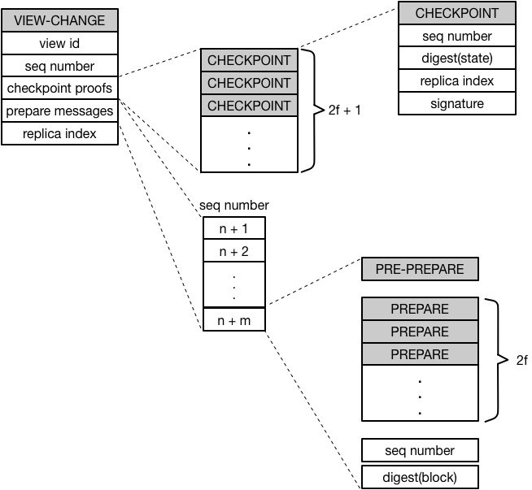

VIEW-CHANGE 消息包含的内容比较多：  
首先需要基于一个稳定的 checkpoint，因此需要包含 2f+1 个 CHECKPOINT 消息以证明该 checkpoint 是有效的。  
然后，在该 checkpoint 之上的所有 sequence number，都需要打包对应的 PRE-PREPARE 消息以及 2f 个 PREPARE 消息。

#### New-view 数据结构 {#new-view-数据结构}

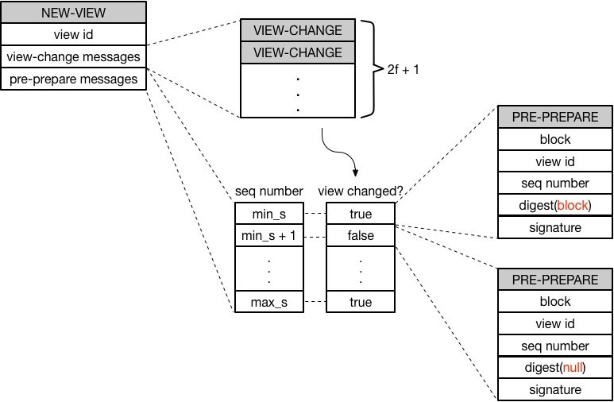

NEW-VIEW 消息首先需要包含 2f+1 个 VIEW-CHANGE 消息，以证明确实有超过 2/3 的节点同意在更高的 view 上进行新一轮共识。  
然后，根据收到的所有 VIEW-CHANGE 消息中的 checkpoint 信息，找出最小值 min\_s 和最大值 max\_s，打包该区间内的每一个 sequence number 对应的 PRE-PREPARE 消息。

特别的，为了减少重复验证，如果在某个 sequence number 上从未进行过 view change（即第一轮就达成了共识），则 PRE-PREPARE 中包含一个特殊的 null 请求的摘要信息。

具体逻辑参见下图：

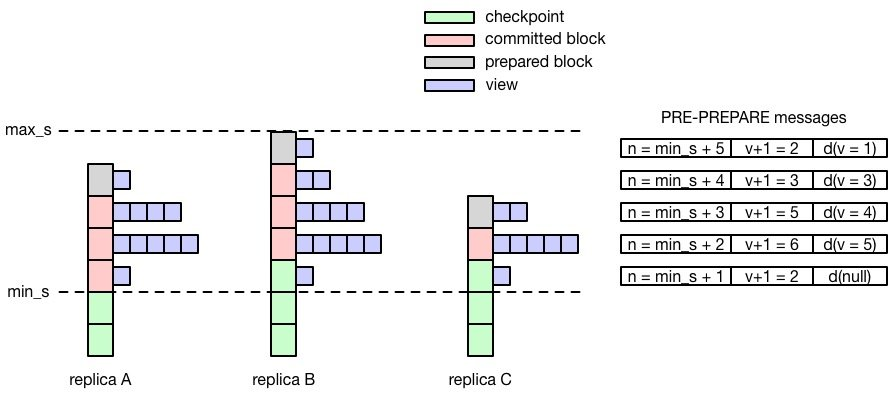

### 一种优化流程 {#一种优化流程-1}

`view-change` 在主节点异常的时候需要需要能够发现，而主节点异常无外乎两种情况：

1. 主节点宕机
2. 主节点是恶意节点，发送错误消息

针对 1. 可以用心跳机制进行检测；

针对 2. 首先我们要明确其检测恶意节点的机制，一种方式是校验`prepare`消息中的请求签名,这种方式可以发现节点篡改，而针对消息顺序的篡改，可以通过一种简单约定，比如必须要按照绝对时间顺序排序等；

当然如果一直由某一个特定节点打包，带来的问题是网络不公，这个问题有一种优化是每轮共识都重选主节点，还有一些优化是可以通过设置轮换间隔进行控制。

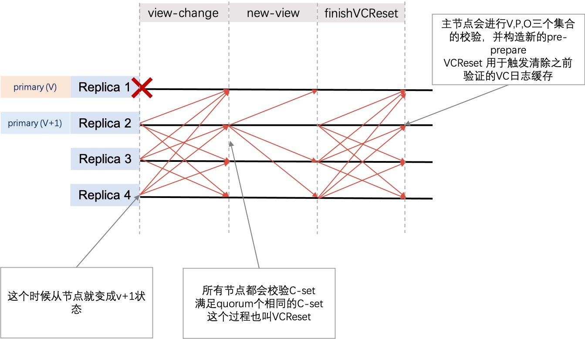

**RBFT ViewChange流程**

上图中，`Primary(v)` 为拜占庭节点，需要进行 ViewChange，与原有发起VC的主要流程是一致的，但多了一个 finishVCReset 的过程，这个过程主要是确认所有节点接受了新节点，并且将自身的状态进行了一个变更，流程细节如下：

（1）从节点在检测到主节点有异常情况（没有按时收到nullRequest消息）或者接收到来自其他f+1个节点的ViewChange消息之后会向全网广播ViewChange消息，自身view从v更改为v+1；

（2）新视图中主节点收到N-f 个ViewChange消息后，根据收到的ViewChange消息计算出新视图中主节点开始执行的checkpoint和接下来要处理的交易包，封装进NewView消息并广播，发起VcReset；

（3）从节点接收到NewView消息之后进行消息的验证和对比，如果通过验证，进行VcReset，如果不通过，发送ViewChange消息，进行又一轮ViewChange；

（4）所有节点完成VcReset之后向全网广播FinishVcReset；

（5）每个节点在收到N-f个FinishVcReset消息之后，开始处理确定的checkpoint后的交易，完成整个ViewChange流程；

由于共识模块与执行模块之间是异步通信的，而 ViewChange 之后执行模块可能存在一些无用的 validate 缓存，因此共识模块需要在ViewChange完成之前通知执行模块清除无用的缓存，Hyperchain共识通过VcReset事件主动通知执行模块清除缓存，并在清理完成之后才能完成ViewChange；

> 这其实是架构设计上的一个问题，因为共识和执行模块从内部实现的角度看应该是异步的，因此共识尽管认为已经VC完成，但是执行模块可能还在异步处理当中，这个过程需要新增一个`finishVCReset`加以确定。

## 主动恢复流程 {#主动恢复流程}

区块链网络在运行过程中由于网络抖动、突然断电、磁盘故障等原因，可能会导致部分节点的执行速度落后于大多数节点。在这种场景下，节点需要能够做到自动恢复才能继续参与后续的共识流程。为了解决这类数据恢复的问题，RBFT 算法提供了一种动态数据自动恢复的机制 (recovery)，recovery 通过主动索取现有共识网络中所有节点的视图、最新区块等信息来更新自身的存储状态，最终同步至整个系统的最新状态。在节点启动、节点重启或者节点落后的时候，节点将会自动进入 recovery，同步至整个系统的最新状态。

### 自主恢复流程 {#自主恢复流程}

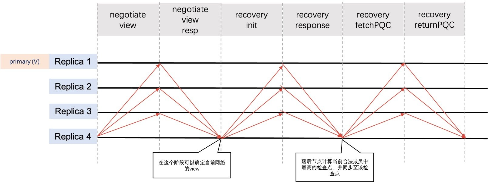

上图中，Replica 4 为落后节点，需要进行 recovery。此节点在 RBFT 中的自动恢复流程如下：

1. Replica 4 首先广播 NegotiateView 消息，获取当前其余节点的视图信息；
2. 其余三个节点向 Replica 4 发送 NegotiateViewResponse，返回当前视图信息，此时可以确定网络中的view情况。
3. Replica 4 收到 quorum 个 NegotiateViewResponse 消息后，更新本节点的视图，即当前的view信息，应该认识到 N信息应该是预先配置好的；
4. Replica 4 广播 RecoveryInit 消息到其余节点，通知其他节点本节点需要进行自动恢复，请求其余节点的检查点信息和最新区块信息；
5. 正常运行节点在收到 RecoveryInit 消息之后，发送 RecoveryResponse，将自身的检查点信息以及最新区块信息返回给 Replica 4 节点；
6. Replica 4 节点在收到 quorum 个 RecoveryResponse 消息后，开始尝试从这些 response 中寻找一个全网共识的最高的检查点，随后将自身的状态更新到该检查点， 此时仅仅有checkpoint的高度，其实内部的`PQC-set`均没有同步，也就是说，这个时候如果需要检查checkpoint的合法性的话，只能依靠数量检查；
7. Replica 4 节点向正常运行节点索要检查点之后的 PQC （即前文所述的POC-set数据）数据，最终同步至全网最新的状态。

## 增删节点流程 {#增删节点流程}

在联盟链场景下，由于联盟的扩展或者某些成员的退出，需要联盟链支持成员的动态进出服务，而传统的 PBFT 算法不支持节点的动态增删。RBFT 为了能够更加方便地控制联盟成员的准入和准出，添加了保持集群非停机的情况下动态增删节点的功能。

### 增加节点 {#增加节点}

`Replica 5`新节点加入的流程如下图所示；

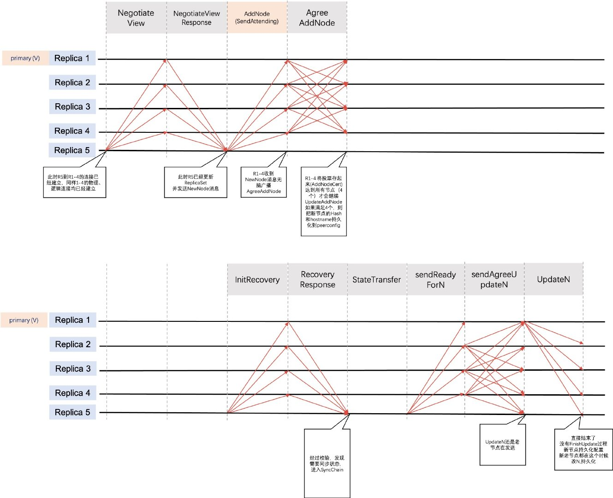

- 新节点启动之后，读取本地配置信息，需要是被自身为新增节点，并进行view的协商流程
- view协商完成以后，向网络中其他节点建立连接并且发送`AddNode`消息；
- 当集群中的节点收到`AddNode`消息后，会广播`AgreeAdd`的消息，此时，**新节点已经能够从原来网络集群中同步数据了**，甚至于说，只要其中某个同意了就可以从同意的节点同步数据，其实可能全网还没有完全同意新增；

> 原有设计与实现略有偏差：
>
> 当现有节点收到N条（N为现有区块链共识网络中节点总数）AddNode消息后，更新自身的路由表，随后开始回应新增节点的共识消息请求（在此之前，新增节点的所有共识消息是不予处理的）；

- 完成view协商之后，5号节点同时会进行recovery动作，完成recovery之后，向全网现有节点广播ReadyForN请求；
- 现有节点在收到ReadyForN请求后，重新计算新增节点加入之后的N,view等信息，随后将其与PQC消息封装到AgreeUpdateN消息中，进行全网广播；
- - Replica 5加入后的共识网络会产生一个新的主节点，该主节点在收到`N-f`个AgreeUpdateN消息后，以新的主节点的身份发送UpdateN消息；
- 全网所有节点在收到UpdateN消息之后确认消息的正确性，进行VCReset；
- 每个节点完成VCReset后，全网广播 `FinishUpdateN` 消息；
- 节点在收到 `N-f` 个 `FinishUpdateN` 消息后，处理后续请求，完成新增节点流程。

### 删除节点 {#删除节点}

删除节点比增加节点稍微简单一些， 因为没有数据同步过程，但是存在变更触发的问题，新增节点可以通过新节点主动触发， 但是删除节点需要客户端进行触发，删除节点不存在部分节点成功的问题，因此也有一个限制，就是必须要所有节点同时变更。

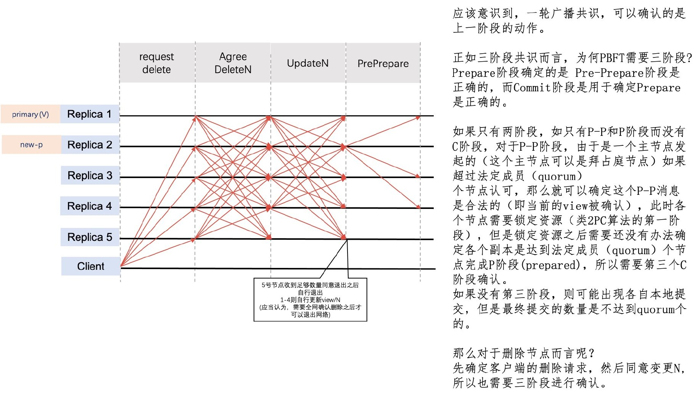
> 上图简单分析了删除节点需要额外阶段确认的原因，我认为确认可以提升整个系统的健壮性。在删除节点这个过程当中，实际操作会要求所有节点达到确定退出并更新N的状态，也就是说，不仅仅要求quorum个节点，而是要求所有节点，来满足整体网络的可运行与健壮性（当然这个是工程上的考虑）。

## 附加概念 {#附加概念}

### 交易池 {#交易池}

在区块链系统当中，交易池 (TxPool) 是常见的，对于PBFT算法而言不是必须的，但是为了能够便于下文理解，先在主流程内简单介绍一下。

交易池用于缓存交易数据，交易池其实扮演了蓄洪的作用，一方面缓冲了外部请求的压力，另一方面，也让交易处理更加稳定，减少了请求毛刺。在区块链节点接收到交易之后，将会把交易缓存到自己的交易池当中，随后向全网广播交易，通过该机制，可以让所有的节点都能够拥有完整的交易列表（如果从节点在验证之前发现缺少了某些交易，也只需要向主节点索取缺少的那些交易而不用索取整个区块里面所有的交易），从而满足PBFT只需要广播交易Hash进行共识的条件，上述方式较传统方式可以减小传输带宽，降低主节点压力，提升共识稳定性。

尽管下图的以太坊交易池的作用有所不同，但是思想其实是一致的，都是把交易进行一个缓冲，降低共识的压力。

以太坊交易池

## 延伸阅读 {#延伸阅读}

PBFT是第一个得到广泛应用的 BFT 算法。随后业界还提出了若干改进版的BFT共识算法。

> 以下内容参考自 [高性能联盟区块链技术研究](http://www.jos.org.cn/html/2019/6/5737.htm)

文献[14]: Q/U 提出了一种可伸缩的故障容忍方法，系统可根据需要配置可容忍的故障数量，而不会显着降低性能。Q / U是一种quorum-based协议，可用于构建故障可扩展的拜占庭式容错服务。相较使用agreement-based的副本状态机协议，Q / U协议可以提供更好的吞吐量和故障可伸缩性。使用Q / U协议构建的原型服务在实验中优于使用副本状态机实现的相同服务，使用Q / U协议时，性能减少了36％，而拜占庭式容错的数量从1增加到5，使用副本状态机协议时，性能下降了83％。

文献[15]: HQ提出了一种混合拜占庭式容错状态机副本协议，在没有争用的情况下，HQ采用轻量级的基于仲裁的协议，节省了副本间二次通信的成本。一旦出现争议，HQ则使用BFT解决争用。此外，总部仅使用3f + 1个副本来容忍f个故障，为节点故障提供了更佳优秀的恢复能力。

文献[16]: Zyzzyva 提出了一种使用推测来降低成本并简化拜占庭容错状态机副本的协议。在Zyzzyva中，副本可直接响应客户端的请求，而不需要首先运行PBFT的三阶段共识协议来完成请求的定序处理。副本节点可采用主节点提出的请求定序，并立即回应客户端。副本节点可能会出现不一致，一旦客户端检测到不一致，将帮助副本节点收敛在单一请求定序上。同时，Zyzzyva将副本节点开销降低到了理论最小值附近。

文献[17]: High throughput BFT提出了一种高吞吐量的拜占庭式容错架构，它使用特定应用程序的信息来识别和同时执行独立的请求。该体系结构提供一种通用的方法来利用应用程序间的并行性，在提高吞吐量的同时，还不损害系统工作的正确性。

文献[18]: Aardvark算法提出了一种实用的BFT方法，通常被称为RBFT（Robust BFT）算法，RBFT算法使得系统在面对最好和最坏的情况下，性能都能大致保持不变，极大的提高了系统的可用性。

# 参考文献 {#参考文献}

[1]. [Quorum (分布式系统)](https://zh.wikipedia.org/zh-tw/Quorum_(%E5%88%86%E5%B8%83%E5%BC%8F%E7%B3%BB%E7%BB%9F))

[2]. [osdi99](https://pmg.csail.mit.edu/papers/osdi99.pdf)

[3]. [Making Byzantine Fault Tolerant SystemsTolerate Byzantine Faults (Aardvark)](https://www.usenix.org/legacy/event/nsdi09/tech/full_papers/clement/clement.pdf)

[4]. [共识算法系列之一：raft和pbft算法](https://zhuanlan.zhihu.com/p/35847127)

[5]. [PBFT基础流程](https://fisco-bcos-documentation.readthedocs.io/zh_CN/latest/docs/design/consensus/pbft.html)

[6]. [hyperchain RBFT说明文档](https://hyperchain.readthedocs.io/zh_CN/latest/consensus.html)

[7]. [PBFT实用拜占庭容错算法深入详解](https://blog.csdn.net/TurkeyCock/article/details/81672759)

[8]. [共识 | 拜占庭容错的代表 PBFT](https://zhuanlan.zhihu.com/p/56780298)

[9]. [详解实用拜占庭容错协议](https://zhuanlan.zhihu.com/p/78010422)

[10]. [Hyperledger Fabric中PBFT算法详解](https://zhuanlan.zhihu.com/p/48899458)

[11]. <https://www.the-paper-trail.org/post/2008-08-13-a-brief-tour-of-flp-impossibility/>

[12]. [区块链共识算法的发展现状与展望](http://www.aas.net.cn/article/doi/10.16383/j.aas.2018.c180268)

[13]. [朱立, 俞欢, 詹士潇, 邱炜伟, & 李启雷. (2019). 高性能联盟区块链技术研究. *Journal of Software*, *30*(6).](http://www.jos.org.cn/html/2019/6/5737.htm)

[14]. Abd-El-MalekM, Ganger GR, Goodson GR, Reiter MK, Wylie JJ. Fault-scalable Byzantine fault-tolerant services. ACM SIGOPS Operating Systems Review, 2005, 39(5): 59-74. [doi:10.1145/1095809]

[15]. Cowling J, Myers D, Liskov B, Rodrigues R, Shrira L. HQ replication: A hybrid quorum protocol for Byzantine fault tolerance. In: Proc. of the 7th Symp. on Operating Systems Design and Implementation. USENIX Association, 2006.177-190.

[16]. Kotla R, Dahlin M. High throughput Byzantine fault tolerance. In: Proc. of the 2004 Int’l Conf. on Dependable Systems and Networks. IEEE Computer Society, 2004.575.

[17]. Kotla R, Alvisi L, Dahlin M, Clement A, Wong E. Zyzzyva:Speculative byzantine fault tolerance. ACM SIGOPS Operating Systems Review, 2007, 41(6): 45-58. [doi:10.1145/1323293]

[18]. Clement A, Wong EL, Alvisi L, Dahlin M, Marchetti M. Making Byzantine fault tolerant systems tolerate Byzantine faults. In: Proc. of the NSDI, Vol.9.2009.153-168.
